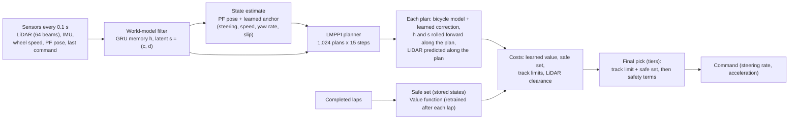

# SIT-LMPC with an RSSM world model (F1TENTH)

ESE 6150 Team 8. This repository runs SIT-LMPC (learning model predictive control with a sampled safe set and a
learned value function) on the ROS 2 F1TENTH simulator, and replaces its car model with a **world model**: a
recurrent state-space model that reads the raw sensors every 0.1 s, keeps a memory of what it has seen, and predicts
both the car's motion and what its LiDAR will see. The goal is a racing controller that keeps working when
conditions change during a session (grip drops, low-grip patches).

The package started as SIT-LMPC Remastered (known-dynamics and Gaussian-BNN presets, kept under
[Upstream package](#upstream-package)).

## Contents

1. [Architecture](#architecture)
2. [Branches](#branches)
3. [Setup](#setup)
4. [How to run](#how-to-run)
5. [Components: learned or hand-written, defaults, status](#components)
6. [Datasets](#datasets)
7. [Key results](#key-results)
8. [Known limitations](#known-limitations)
9. [Documents](#documents)
10. [Upstream package](#upstream-package)

## Architecture



**The prediction step** (model `rssm-v11`, details in [docs/WORLD_MODEL_RSSM.md](docs/WORLD_MODEL_RSSM.md)):

1. A filter updates a GRU memory h (128) and a latent s = (c, d) (8 slow "condition" numbers + 24 fast ones) from
   the raw sensors: 64-beam LiDAR, IMU, wheel speed, particle-filter pose change and the last command. A learned
   anchor head reads steering, speed, yaw rate and slip from (h, s); the pose comes from the particle filter.
2. Next state = **bicycle physics** (nominal F1TENTH single-track model) **+ a learned correction** that depends on
   the body state, the control and (h, s). The position part of the correction is predicted in the car frame.
3. Along a plan, h is advanced by the GRU, c is held fixed and d follows the prior mean, so (h, s) is rolled forward
   with the physical state. It is **not a pure latent rollout**: the physical state is always propagated by the
   bicycle model plus the correction.
4. The same model decodes the LiDAR scan along each plan; plans whose predicted nearest range falls under 0.35 m are
   penalised (the clearance check, the part only a world model can do).

**The planner** is SIT-LMPC's LMPPI: 1,024 sampled plans around last step's plan, one weighted plan per pair of
safe-set/track-limit weights (256), plus last step's plan shifted by one step and three slower copies of it. The final
pick ranks by 1e7 × (body-corner track-limit violation + safe-set violation) + 1000 × safety terms. The safe set is the
convex hull of states from completed laps; the value function (normalizing flow on time-to-go) is retrained after
every lap.

## Branches

| Branch | Content |
|---|---|
| `world-model` | This work: RSSM world model, planner, change handling, all sim results since 2026-11-21 (`EXPERIMENTS.md`) |
| `world-model-guarded-attempt` | An earlier attempt with ensemble heads and a physics check (entries 17–19), kept for reference |
| `ros-sim` | The ROS 2 sim backend, the v3 encoder model (earlier method) and the baselines |
| `irl` | `ros-sim` + the real-car backend (`docs/CAR_DEPLOYMENT.md` there) and the Jetson setup |
| `main` | Upstream package |

## Setup

| Need | Detail |
|---|---|
| ROS 2 | Jazzy, with `~/sim_ws` as the workspace |
| Simulator bridge | `f1tenth_gym_ros` at `1fef653` with `patches/f1tenth_gym_ros-sit-lmpc.patch` applied (`git apply` in `src/f1tenth_gym_ros`): lockstep stepping, simulated IMU/wheel/PF sensors, LiDAR, condition and friction-zone topics, lap counter |
| Python | `~/sim_ws/.venv` (`uv sync --extra gpu --extra plots --extra dev` from this repository) |
| Trained models | `runs/rssm-v11` (world model), not in git |
| Data | `data/f1tenth-track`, `data/f1tenth-coverage`, not in git (see [Datasets](#datasets)) |
| GPU | developed on a laptop RTX 3070; one sim run at a time (ROS domain 77) |

## How to run

Every sim run goes through one script: it starts the bridge, the condition scheduler (applies the scenario's grip
changes after a given number of completed laps) and the controller.

```bash
bash scripts/run_change_experiment.sh <config> <scenario> <run-name> <attempts>
# results: results/Spielberg/<run-name>/ and results/Spielberg/<run-name>.log
```

| Config | Controller | Learned parts | Hand-written rules |
|---|---|---|---|
| `configs/fast-diag/known-varied-warmup.yaml` | bicycle model (nominal parameters) | value function | – |
| `configs/world/rssm-latent-v11.yaml` | v11 world model | world model, value | – |
| `configs/world/rssm-latent-v11-change.yaml` (= `-react.yaml`) | v11 + change detection + speed reaction | world model, value | change detection, speed caps, braking plans, cap raising |
| `configs/retry/*.yaml` | the same controllers in retry mode (a crash restarts the car at the start line; the run ends after N attempts): `bicycle`, `v11`, `v11-diag` (with the per-candidate cost log), `v11-react`, `v11-learned`, `bicycle-react` | | |
| `configs/retry/v11-learned.yaml` | v11 + learned change handling, no speed caps | world model, value with the condition tag as input | change detection, tag matching for the safe set |

| Scenario | Change |
|---|---|
| `configs/scenarios/spielberg-no-change.yaml` | none |
| `spielberg-grip-drop-lap8.yaml` | μ 1.05 → 0.7 on the whole track after 8 laps |
| `spielberg-grip-drop055-lap8.yaml` | μ 1.05 → 0.55 after 8 laps |
| `spielberg-patch-lap8.yaml` / `spielberg-patch045-lap8.yaml` | μ 0.6 / 0.45 on the corner at s = 85–115 m after 8 laps |
| `spielberg-mass-lap8.yaml` | mass +30% after 8 laps (barely matters in this sim, entry 32) |

Examples:

```bash
# v11 on a harsh grip drop, retry mode, 25 attempts
bash scripts/run_change_experiment.sh configs/retry/v11.yaml configs/scenarios/spielberg-grip-drop055-lap8.yaml my-run 25
# report: crashes per attempt, lap times, clearance, speed after the change, planner counters
python scripts/rt_report.py my-run
# why the planner chose what it chose before each crash (needs the cost log: configs/retry/v11-diag.yaml)
python scripts/dg_report.py my-run
# train the world model
python -m sit_lmpc.world.rssm_train --config configs/train-rssm-v11.yaml --output runs/rssm-v11
# browse the training data (episode path on the map, states, grip, LiDAR)
python scripts/view_dataset.py --map Spielberg --change patches
# top-down video of a run
python scripts/render_run_video.py results/Spielberg/my-run --speedup 2
```

Tests: `JAX_PLATFORMS=cpu python -m pytest -q tests/unit/test_planner_structure.py tests/unit/test_rssm.py`.

## Components

"Structural" means part of the method's design (it follows from LMPC or from the model); "patch" means a hand-set
rule added to work around a specific failure.

| Component | Kind | Default | Status | Entry |
|---|---|---|---|---|
| World model rssm-v11 (filter, correction, anchor, LiDAR/sensor decoders) | learned offline | on in the world configs | structural | 29 |
| Bicycle model inside the prediction | fixed physics | on | structural | 4 |
| LiDAR clearance check (margin 0.35 m, weight 1) | learned prediction, hand-set margin | on | structural (margin hand-set) | 11, 30 |
| Value function (normalizing flow on time-to-go) | learned online | on | structural (SIT-LMPC) | – |
| Safe set: convex hull of completed laps' states | data + rules | on | structural (SIT-LMPC) | – |
| Final pick tiers: track limit + safe set hard, safety terms below | rule | on | structural fix | 42 |
| Last step's plan kept as a sample and a candidate | rule | on | structural fix (LMPC recursive feasibility) | 42 |
| Body-corner track limit, half-width − 0.10 m (1.00 m) | rule | on | structural fix (replaces a double-counted 0.85 m) | 37, 42 |
| Stored states outside the body-corner limit dropped | rule | on | structural fix | 42 |
| Reduced-speed candidates (0.9 / 0.75 / 0.6 × last plan) | rule | on | structural (candidate diversity) | 44 |
| Hull compiled and chunked on the host | code | on | fix | 1 |
| Warm-up: pure pursuit, varied speed profile capped at 9 m/s | rule | on | patch | 13 |
| Change detection (bicycle 1.0 s error tag per 10 m stretch) | rule | change configs only | patch (thresholds hand-set) | 34 |
| Speed reaction: caps, strong/soft phases, braking plans, cap raising | rule | `rssm-latent-v11-change.yaml` only | patch | 39–41 |
| Speed-scaled safe set after a detection (same factor as the caps) | rule | on when change detection is on | structural fix for the change case | 44 |
| Learned change handling: tag-matched safe set, tag-conditioned value | learned value + matching rule | `configs/retry/v11-learned.yaml` only | experimental | 43–44 |
| Crash-risk head | learned | off | experimental, failed | 22 |
| Slip cost, speed cap, track-limit margin | rule | off | patches, removed from defaults | 15, 23, 25 |

## Datasets

Not in git; collected with the sim's single-track model and the same sensor and LiDAR models as the closed-loop sim.
Browse them with `python scripts/view_dataset.py` (`--overview` for summary charts).

| Dataset | Size | Content | Used for |
|---|---|---|---|
| `data/f1tenth-track` | 4,584 episodes, 684k steps of 0.1 s (Spielberg 394k, custom1 138k, Levine sim 152k) | on-track driving with 1080-beam LiDAR: random vehicles (grip 0.4–1.2, stiffness ±15%, mass 0.8–1.3), step changes and low-grip patches, fast laps, the planner's own laps, hard manoeuvres, spins and spin onsets | RSSM training (all versions) |
| `data/f1tenth-coverage` | 1,994 episodes, 273k steps | open space, segments chosen to fill speed × steering × slip × yaw-rate cells; 84% end in loss of control | RSSM v10/v11 (slides and fast cornering) |
| `data/f1tenth-world` | 2,310 trajectories, 236k transitions | map-free sensor data with condition changes | v3 encoder (earlier model) |
| `data/f1tenth-vehicle`, `-wide` | map-free vehicle transitions | | v3 residual transition |

Distributions and coverage: [docs/DATA_DISTRIBUTIONS.md](docs/DATA_DISTRIBUTIONS.md).

## Key results

All on Spielberg in the ROS lockstep sim; every number and run is in [EXPERIMENTS.md](EXPERIMENTS.md).

| Result | Entry |
|---|---|
| The planner compiled GPU code while driving (p95 236 ms); moving the hull work to the host gave p95 30 ms | 1 |
| A flat, slow warm-up breaks SIT-LMPC on its own (no speed contrast for the value function); a varied warm-up fixes it | 13 |
| rssm-v11: 1.5 s lateral error from the true state 0.26 m median / 1.36 m p95 (v8 0.36 / 1.73, earlier v3 model 0.18 / 1.63) | 29 |
| First world-model run with all learned laps: 15/15, best 36.9 s (bicycle model 36.0 s) | 30 |
| Grip drop to μ 0.7: v11 survives and recovers in about 4 laps; the bicycle model spins | 31 |
| Live change detection from the bicycle-error tag: delay 0.4–1.6 s, no false detections | 34, 39–41 |
| Harsh changes (μ 0.55 everywhere, μ 0.45 patch): every controller crashes without extra handling | 38 |
| Hand-written speed reaction: survival up (6 of 8 harsh runs finished in entry 40) but many hand-set parts and side effects | 39–41 |
| Boxed-in stops at s ≈ 107 m: the safe set was only a soft cost and last step's plan was not a candidate; fixed structurally | 41–42 |
| Retry mode, 25 attempts: without a working way to slow down, every controller crashed on all 17 attempts after a harsh change; the candidate set held no slow plan | 43 |
| Speed-scaled safe set and reduced-speed candidates | 44 |

## Known limitations

- **Rollout accuracy at speed.** v11's median 1.5 s error above 9 m/s is about twice the earlier v3 model's.
- **The model does not foresee a spin after a grip drop.** Its predicted slip for fast and slower plans is about the
  same just before crashes, so the planner keeps choosing fast plans (entry 43).
- **Grip read-out.** The condition latent c tracks grip only weakly; change detection uses the bicycle-error tag
  instead.
- **Hand-written parts.** Change detection thresholds and the speed reaction are rules with hand-set numbers.
- **No learning from crashes.** Crash attempts are stored but no between-lap learner uses them.
- **Retry restarts at speed.** After a crash the car restarts at the start line at about 9 m/s, so every retry meets
  the new condition at race speed.
- **Sim only.** The world model has not been run on the real car; Jetson timing and its Python 3.12 / CUDA setup are
  open.
- **One map in closed loop.** All closed-loop results are on Spielberg.

## Documents

| Document | Content |
|---|---|
| [EXPERIMENTS.md](EXPERIMENTS.md) | every experiment since 2026-11-21: setup, results, verdict, corrections |
| [docs/WORLD_MODEL_RSSM.md](docs/WORLD_MODEL_RSSM.md) | the world model: structure, equations, losses, training, data, planner, change log |
| [docs/WORLD_MODEL_CLOSED_LOOP.md](docs/WORLD_MODEL_CLOSED_LOOP.md) | closed-loop status |
| [docs/WORLD_MODEL.md](docs/WORLD_MODEL.md) | the earlier v3 encoder model (baseline) |
| [docs/DATA_DISTRIBUTIONS.md](docs/DATA_DISTRIBUTIONS.md) | dataset distributions and coverage |
| [docs/SIT_LMPC_ROS_CHANGES.md](docs/SIT_LMPC_ROS_CHANGES.md) | changes made to run SIT-LMPC on ROS 2 |
| [docs/PROGRESS_LOG.md](docs/PROGRESS_LOG.md) | history before 2026-11-21 |

## Upstream package

The package also contains the SIT-LMPC Remastered presets: known dynamics and a Gaussian BNN with latent posterior
updates and chance constraints, in the bundled F1TENTH gym (`vendor/f1tenth_gym`, commit `1e35dc9`).

```bash
uv sync --extra gpu --extra plots --extra dev
uv run sit-racecar                                   # known-dynamics SIT-LMPC
uv run sit-racecar --config configs/bnn-chance.yaml  # BNN + chance constraints
uv run python examples/racecar/run_example.py --controller known-dynamics
```

| Command | Purpose |
|---|---|
| `sit-racecar` | warm-up, value learning, LMPC (all configs above) |
| `sit-track` | MPPI tracking without LMPC value learning |
| `sit-replay` | saved trajectories and plots |
| `sit-insight` | recorded control-step diagnostics |
| `sit-train-value` | offline value training |
| `sit-import-bnn` | import a pretrained BNN checkpoint |

Background: [docs/ARCHITECTURE_AND_DYNAMICS.md](docs/ARCHITECTURE_AND_DYNAMICS.md),
[docs/MIGRATION_VALIDATION.md](docs/MIGRATION_VALIDATION.md), [examples/racecar](examples/racecar/README.md).
