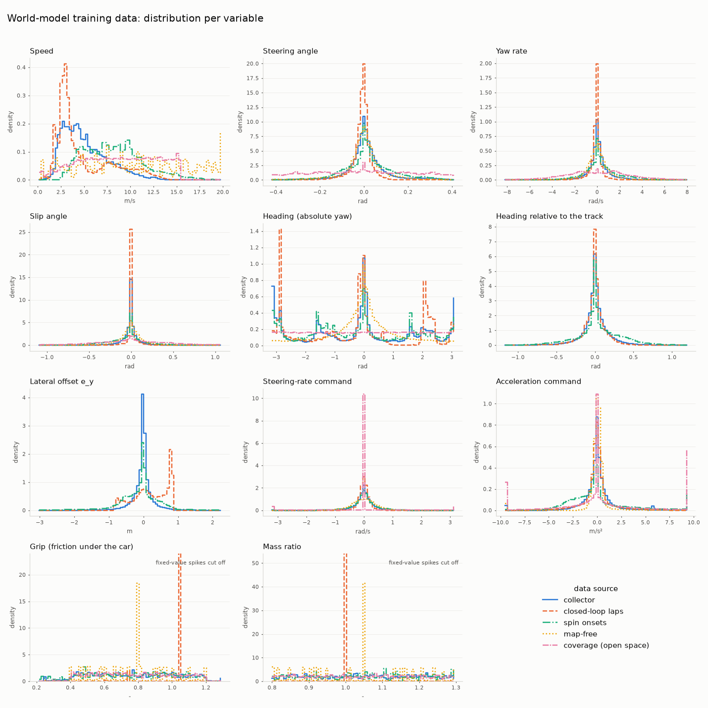
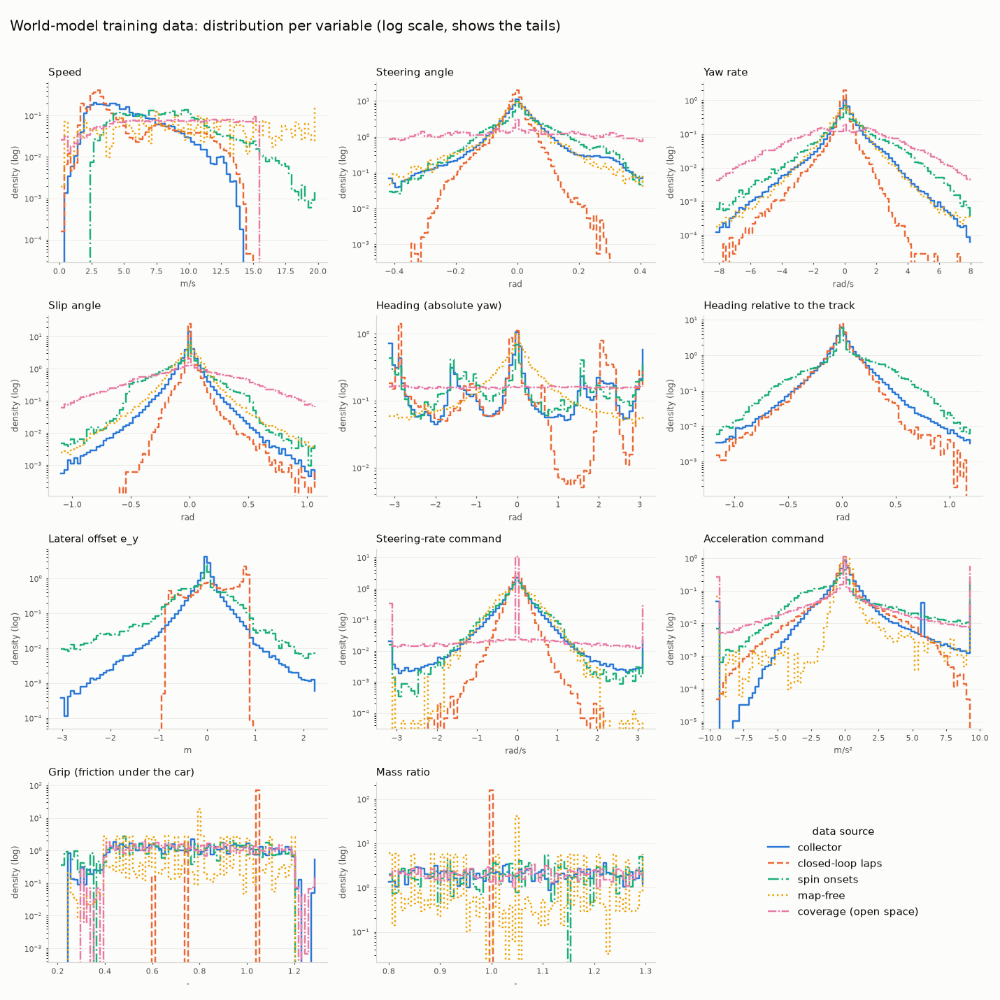
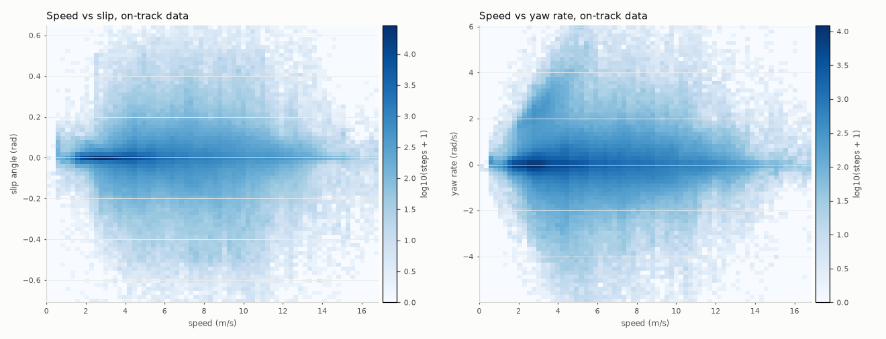
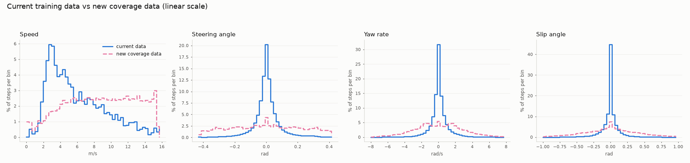
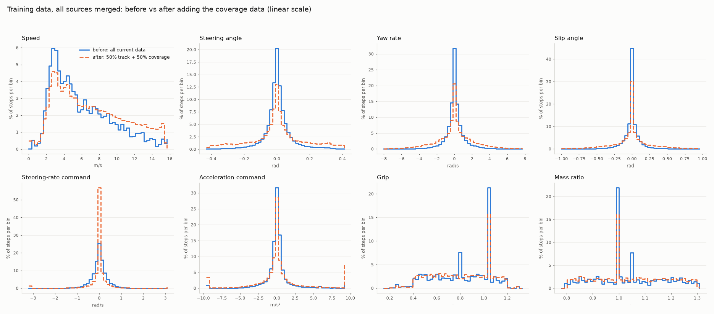
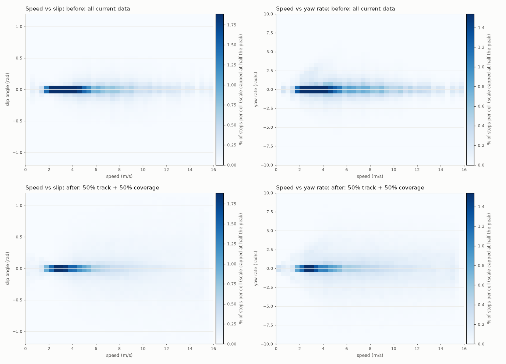

# World-model training data: distributions

Made with `python scripts/dataset_distributions.py` (numbers in `results/data-distributions.json`).

## Data

| Source | Episodes | Steps (0.1 s) | Maps | What it is |
|---|---|---|---|---|
| Collector | 1,435 | 397,575 | Spielberg 168k, custom1 110k, Levine 118k | random vehicles driven by a noisy pure-pursuit driver, 30% no change, 30% step change of grip/mass, 40% low-grip patches |
| Closed-loop laps | 269 | 178,944 | Spielberg | the planner's own laps from earlier sim runs; nominal vehicle |
| Spin onsets | 2,880 | 74,109 | Spielberg 23k, custom1 28k, Levine 21k | 360 groups × 8 perturbed rollouts near the grip limit (corner entry, low-grip patch, steering kick) |
| Map-free | 1,960 | 220,801 | none (open space) | the older excitation dataset, train split; 30% of each v8 training batch |

On-track data is cleaned as for training: every episode ends before the first wall contact and before slip > 1.2 rad
or yaw rate > 10 rad/s. "Steps" counts states.

## How to read the shape column

For each variable the KS distance (0 = identical, 1 = completely different) is computed to a normal fit and to a
uniform distribution over the 0.5–99.5% range. Below 0.1 the shape is called close to that distribution. Skewness
beyond ±1 is noted as skewed. Excess kurtosis above 3 is noted as peaked with heavy tails: a tall spike at the centre
and more extreme values than a normal distribution would give.

## All on-track data (650,628 steps)

| Variable | Unit | Range (min .. max) | 1–99% range | Mean | SD | Skew | Excess kurtosis | Shape |
|---|---|---|---|---|---|---|---|---|
| Speed | m/s | 0.02 .. 20.0 | 1.58 .. 13.35 | 5.38 | 2.87 | +0.97 | +0.5 | single hump, long right tail |
| Steering angle | rad | −0.43 .. 0.43 | −0.26 .. 0.32 | 0.01 | 0.09 | +0.46 | +5.2 | peaked at 0, heavy tails |
| Yaw rate | rad/s | −9.95 .. 9.99 | −3.29 .. 3.53 | 0.06 | 1.07 | +0.15 | +8.8 | peaked at 0, heavy tails |
| Slip angle | rad | −1.20 .. 1.19 | −0.41 .. 0.35 | −0.01 | 0.11 | −0.44 | +12.8 | very peaked at 0, heavy tails |
| Heading, absolute yaw | rad | −π .. π | −3.13 .. 3.13 | −0.16 | 1.90 | +0.04 | −1.1 | several peaks: the directions of the track's straights |
| Heading relative to the track | rad | −3.14 .. 3.12 | −0.59 .. 0.62 | 0.01 | 0.20 | +0.15 | +15.1 | very peaked at 0, heavy tails |
| Lateral offset e_y | m | −4.0 .. 8.4 * | −1.21 .. 0.85 | 0.03 | 0.44 | −0.53 | +8.9 | peaked at 0, heavy tails |
| Steering-rate command | rad/s | −3.20 .. 3.20 | −1.19 .. 1.14 | 0.00 | 0.41 | −0.12 | +16.7 | very peaked at 0, heavy tails |
| Acceleration command | m/s² | −9.51 .. 9.51 | −5.59 .. 9.51 | 0.09 | 2.06 | +0.76 | +8.6 | peaked at 0, heavy tails, piles at the ±9.51 limits |
| Grip | – | 0.18 .. 1.30 | 0.25 .. 1.20 | 0.84 | 0.25 | −0.55 | −0.9 | broad and flat, plus a spike at 1.05 (closed-loop laps) |
| Mass ratio | – | 0.80 .. 1.30 | 0.81 .. 1.29 | 1.04 | 0.12 | +0.33 | −0.6 | flat, plus a spike at 1.0 (closed-loop laps) |

\* custom1 is a wide track (99th percentile |e_y| 2.67 m); a few Spielberg points (max 8.9 m on a 1.1 m half-width
track) are track-projection jumps. Use the 1–99% range for e_y.

None of the vehicle-motion variables (steering, yaw rate, slip, heading relative to the track, commands) is normal or
uniform: all are sharply peaked at zero with heavy tails, closer to a Laplace shape. Most driving is near-straight,
gentle cornering; hard cornering and slides are rare but present.

## Per source

| Variable | Collector | Closed-loop laps | Spin onsets | Map-free |
|---|---|---|---|---|
| Speed, mean ± SD | 5.10 ± 2.40 m/s | 4.84 ± 3.05 m/s | 8.22 ± 3.13 m/s | 10.41 ± 5.51 m/s |
| Speed, 1–99% | 1.6 .. 12.1 m/s | 1.5 .. 12.9 m/s | 3.0 .. 16.8 m/s | 0.5 .. 20.0 m/s |
| Speed, shape | close to normal, right-skewed | peak at 2.5–3.5 m/s, long tail | close to normal | close to uniform (by design) |
| Steering, 1–99% | −0.30 .. 0.33 rad | −0.16 .. 0.09 rad | −0.28 .. 0.33 rad | −0.33 .. 0.30 rad |
| Yaw rate, 1–99% | −3.4 .. 3.3 rad/s | −2.2 .. 1.4 rad/s | −4.5 .. 5.2 rad/s | −3.1 .. 3.2 rad/s |
| Slip, 1–99% | −0.35 .. 0.32 rad | −0.15 .. 0.19 rad | −0.55 .. 0.50 rad | −0.47 .. 0.48 rad |
| Slip, SD / excess kurtosis | 0.11 / +14.4 | 0.05 / +42.7 | 0.21 / +2.1 | 0.16 / +8.2 |
| Heading relative to track, 1–99% | −0.57 .. 0.59 rad | −0.50 .. 0.39 rad | −0.78 .. 0.85 rad | – |
| e_y, 1–99% | −1.03 .. 0.82 m | −0.80 .. 0.84 m | −2.79 .. 1.80 m | – |
| e_y, shape | peaked at 0 | two humps: centre and +0.8 m (the planner's line hugs the edge) | peaked at 0, wide tails | – |
| Acceleration, 1–99% | −9.5 .. 8.4 m/s² | −4.6 .. 4.9 m/s² | −6.1 .. 9.5 m/s² | −9.5 .. 7.1 m/s² |
| Grip, range / shape | 0.25 .. 1.30, flat (≈ uniform 0.4–1.2, patches below) | 0.60 .. 1.05, almost all 1.05 | 0.18 .. 1.20, flat | 0.25 .. 1.20, a set of fixed vehicle values |
| Mass ratio, range / shape | 0.80 .. 1.30, uniform | 1.0 only | 0.80 .. 1.30, uniform | 0.80 .. 1.30, a set of fixed values |

## What it means for the model

| Point | Detail |
|---|---|
| Slides are rare | across all on-track data, \|slip\| > 0.3 rad is 3.6% of steps and > 0.5 rad 0.7%. The spin-onset rollouts are the only source where slip is close to normal with wide spread (SD 0.21 rad) |
| Speed coverage on track tops out around 12–13 m/s | 99% of on-track steps are below 13.4 m/s; only the spin onsets (99%: 16.8 m/s) and the map-free data (uniform to 20 m/s, no walls) go higher |
| The planner's laps differ from the rest | the closed-loop laps have narrow steering and slip, one vehicle, and an e_y hump at the outer edge: the planner drives a different line than the data collector |
| Grip and mass are spread evenly | sampled roughly uniformly in the collector and onset data, so the condition head sees the full range |
| Absolute heading is a track property | its peaks are the directions of each map's straights; the networks never see it (they get steering, speed, yaw rate and slip only) |

## Figures

Distribution of every variable by source (densities; grip and mass spikes from fixed-value sources are cut off):

Same on a log scale, which shows the tails:

Where the on-track data sits in speed vs slip and speed vs yaw rate (colour: log of the step count):

## Open-space coverage data (added later)

`scripts/collect_coverage.py` drives random vehicles in open space with target-driven segments and coverage feedback
over speed × steering × slip × yaw rate (`data/f1tenth-coverage`, 1,994 episodes, 273k steps). Its speed and steering
are close to uniform and its slip spread is about four times the on-track data's (SD 0.41 rad vs 0.11 rad). Of the
5,245 joint cells either dataset reaches, the share with at least 10 steps goes from 25% (current data) to 56% (both).

Current data vs coverage data:

All sources merged, before vs after (training mix: 50% track, 50% coverage):

In the merged mix the share of steps with steering beyond 0.2 rad goes from 5.9% to 25.4%, yaw rate beyond 3 rad/s
from 2.8% to 16.1%, slip beyond 0.3 rad from 4.2% to 23.9%. The mix is flatter but still peaked at zero, because half
of it is track data; sampling the track windows by inverse density (weight ∝ 1/√density, capped at 5×) raises the
slip-beyond-0.3 share of the training mix to 26.5% by window.
