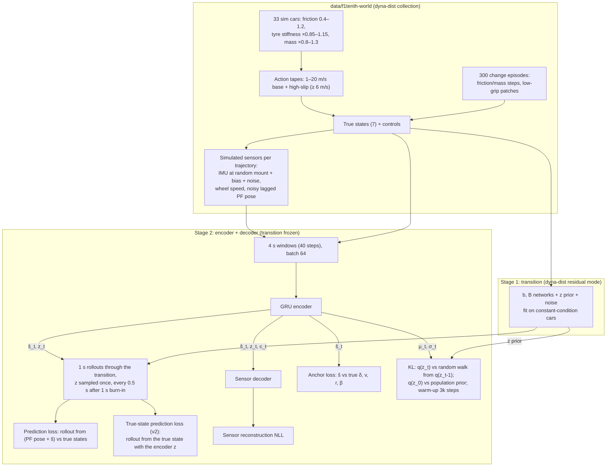
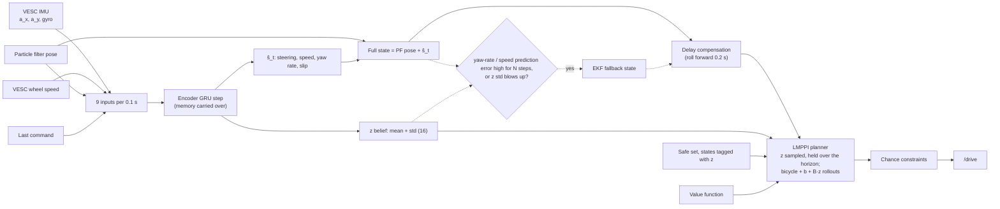

# Physics-grounded world model: architecture and data flow

ESE 6150 Team 8. This is our method, as implemented on `ros-sim`. Code: `src/sit_lmpc/world/`
(`data.py`, `model.py`, `train.py`, `ekf.py`, `evaluate.py`, `runtime.py`, `readout.py`) and the residual transition in `vendor/dyna-dist`.
Status 2026-11-17: transition trained; encoder v3 trained and evaluated (`results/world-eval-v3`); connected to the
planner with a condition-aware safe set and tested in the sim (`results/world-closed-loop`). Car integration not yet run.

## 1. The idea in one line

Next state = **bicycle physics** + **learned correction** + **learned directions × z**. z holds 16 numbers
that describe the car's current conditions. A recurrent **encoder** reads the last seconds of sensor data and
estimates z and the unmeasured state (slip, steering) every 0.1 s.

## 2. Components

| Part | What it is | Inputs → outputs | Trained? | Where |
|---|---|---|---|---|
| Bicycle model f_ST | F1TENTH single-track model, nominal sim-car parameters (μ 1.0489, mass 3.74 kg) | state (7), control (2) → next state | no, fixed | `dyna_dist/models/st.py` |
| Residual network | MLP (128, 128) on normalized [steering, speed, yaw rate, slip, steer rate, accel]. Gives b (7) and B (7×16) | (x, u) → b(x,u), B(x,u) | yes, stage 1 | `runs/residual-world` |
| z prior | Gaussian over z (16): learned mean and full covariance (population of sim cars) | → p₀(z) | yes, stage 1 | same |
| Transition noise | learned per-component variance of the increment | → σ² (7) | yes, stage 1 | same |
| Encoder | GRU (128) → Dense (128, ReLU) → 4 heads | observations o_t (9) → hidden state ŝ_t (4), z mean μ_t (16), z log-std (16), sensor calibration c_t (4) | yes, stage 2 | `world/model.py: Encoder` |
| Observation decoder | MLP (128, 128) + calibration terms | (ŝ_t, z_t, u_t, c_t) → IMU a_x, a_y, gyro, wheel speed | yes, stage 2 | `world/model.py: Decoder` |
| EKF | Extended Kalman filter on f_ST | PF pose, gyro, wheel speed, control → 7-dim state | no (hand-tuned noise) | `world/ekf.py` |

State x = (x, y, steering δ, speed v, yaw ψ, yaw rate r, slip β), with x, y at the center of gravity. Control
u = (steering rate, acceleration).

## 3. The full model in equations

Notation, per 0.1 s step t:

| Symbol | Meaning |
|---|---|
| $x_t$ | state $(x, y, \delta, v, \psi, r, \beta)$ at the CoG; true state $x_t$ exists only in sim |
| $s_t$ | the unmeasured part $(\delta, v, r, \beta)$ |
| $p_t$ | particle-filter pose $(p^x, p^y, p^\psi)$ at the rear axle |
| $u_t$ | control (steering rate, acceleration) |
| $o_t$ | the 9 encoder inputs (section 4) |
| $z_t \in \mathbb{R}^{16}$ | the condition variables |

**Encoder (recurrent belief over the hidden state and z)**

$$h_t = \mathrm{GRU}\big(h_{t-1},\ (o_t - m_o) \oslash s_o\big), \qquad e_t = \mathrm{ReLU}(W_e h_t + b_e)$$

$$\hat s_t = \kappa \odot (W_s e_t), \quad \kappa = [0.2,\ 2,\ 2,\ 0.2]$$

$$\mu_t = W_\mu e_t, \quad \log\sigma_t = \mathrm{clip}(W_\sigma e_t, -6, 2), \quad c_t = W_c e_t$$

The encoder works in **whitened** coordinates $w_t$; the transition receives $z_t = m_0 + L_0 w_t$, where $m_0, L_0$ are the population prior's mean and Cholesky factor:

$$q(w_t \mid o_{\le t}) = \mathcal{N}\big(\mu_t,\ \mathrm{diag}(\sigma_t^2)\big), \qquad z_t = m_0 + L_0 w_t$$

**State assembly (PF pose passed through)**

$$\hat x_t = \big(p^x_t + l_r\cos p^\psi_t,\ \ p^y_t + l_r\sin p^\psi_t,\ \ \hat\delta_t,\ \hat v_t,\ p^\psi_t,\ \hat r_t,\ \hat\beta_t\big)$$

**Transition (bicycle + residual + latent), one step**

$$x_{t+1} = F(x_t, u_t, z) + \varepsilon_t$$

$$F(x, u, z) = x \oplus R(\psi)\Big[\underbrace{\Delta_{ST}(x, u)}_{\text{bicycle, fixed}} + \underbrace{\gamma \odot \big(b_\theta(x,u) + B_\theta(x,u)\, z\big) + m_\Delta}_{\text{learned residual}}\Big]$$

$$\varepsilon_t \sim \mathcal{N}\big(0,\ R(\psi)\,\mathrm{diag}(\gamma^2 \odot \sigma_\varepsilon^2)\,R(\psi)^\top\big)$$

- $\Delta_{ST}$ is the RK4 single-track increment with nominal parameters, in the car's frame.
- $b_\theta \in \mathbb{R}^7$ and $B_\theta \in \mathbb{R}^{7\times16}$ come from one MLP on $(\delta, v, r, \beta, u)$.
- $\gamma$ and $m_\Delta$ are the target normalizer.
- $R(\psi)$ rotates the position increment to the world frame.
- $\oplus$ adds the increment and wraps yaw and slip.

**z dynamics (prior)**

$$p(w_0) = \mathcal{N}(0,\ I) \;\Leftrightarrow\; p(z_0) = \mathcal{N}(m_0,\ L_0 L_0^\top), \qquad p(w_t \mid w_{t-1}) = \mathcal{N}\big(w_{t-1},\ 0.05^2 I\big)$$

(Whitening matters: the prior covariance has condition number ~$10^7$, so a diagonal belief directly in $z$ cannot match it and its KL is huge; see `PROGRESS_LOG.md`, the KL bug.)

**Prediction used in training and planning:** sample once $\tilde z \sim q(z_t)$ and hold it fixed over $H = 10$ steps.

$$\tilde x_{t} = \hat x_t \ (\text{or } x_t \text{ for the true-state check}), \qquad \tilde x_{t+k+1} = F(\tilde x_{t+k},\ u_{t+k},\ \tilde z)$$

**Observation decoder**

$$\hat o_t = g_\eta\big(\hat s_t \oslash \kappa,\ \tilde z_t,\ u_t\big) + (c_{t,1},\ c_{t,2},\ c_{t,3},\ 0), \qquad \hat w_t \leftarrow \hat w_t\,\big(1 + 0.1\tanh c_{t,4}\big)$$

Here $\hat o_t$ is the predicted $(a_x, a_y, \text{gyro}, \text{wheel})$, $c_{t,1..3}$ are the IMU biases, and $c_{t,4}$ is the wheel-speed scale.

**Losses (sim training, window of T = 40 steps, burn-in $T_b = 10$, rollout starts $\mathcal{S} = \{T_b, T_b+5, \dots\}$)**

$$\mathcal{L}_{\text{anchor}} = \frac{1}{T - T_b}\sum_{t \ge T_b} \big\lVert (\hat s_t - s_t) \oslash \sigma_s \big\rVert^2, \quad \sigma_s = [0.02,\ 0.2,\ 0.2,\ 0.02]$$

$$\mathcal{L}_{\text{pred}} = \frac{1}{|\mathcal{S}|\,H}\sum_{t\in\mathcal{S}}\sum_{k=1}^{H} \big\lVert (\tilde x_{t+k} - x_{t+k}) \oslash \sigma_x \big\rVert^2 \ \text{ from } \tilde x_t = \hat x_t, \quad \sigma_x = [0.1,\ 0.1,\ 0.02,\ 0.2,\ 0.02,\ 0.2,\ 0.02]$$

$$\mathcal{L}_{\text{true}} = \text{the same, from } \tilde x_t = x_t \quad (\text{v2 only})$$

$$\mathcal{L}_{\text{obs}} = \frac{1}{T}\sum_t \sum_{j=1}^{4} \Big[\tfrac12\big((\hat o_{t,j} - o_{t,j})/e^{\lambda_j}\big)^2 + \lambda_j\Big]$$

$$\mathcal{L}_{\text{KL}} = \frac{1}{T}\,\mathrm{KL}\big(q(w_0)\,\Vert\,\mathcal{N}(0, I)\big) + \frac{1}{T-1}\sum_{t\ge1}\mathrm{KL}\Big(q(w_t)\ \Big\Vert\ \mathcal{N}\big(\mu_{t-1},\ \mathrm{diag}(\sigma_{t-1}^2) + 0.05^2 I\big)\Big)$$

Both KL terms are between diagonal Gaussians, computed with TensorFlow Probability's JAX version.

$$\mathcal{L} = \mathcal{L}_{\text{anchor}} + \mathcal{L}_{\text{pred}} + w_{\text{true}}\,\mathcal{L}_{\text{true}} + 0.1\,\mathcal{L}_{\text{obs}} + 0.01\,\rho(n)\,\mathcal{L}_{\text{KL}}, \qquad \rho(n) = \min(1,\ n/3000),\ \ w_{\text{true}} \in \{0\ (\text{v1}),\ 1\ (\text{v2})\}$$

Trained in stage 2: $\{\mathrm{GRU}, W_\cdot, g_\eta, \lambda\}$. Frozen in stage 2: $\{\theta, m_0, L_0, \sigma_\varepsilon\}$.
The kept checkpoint is the one with the lowest validation $\mathcal{L}_{\text{anchor}} + \mathcal{L}_{\text{pred}} + \mathcal{L}_{\text{true}}$ (KL and sensor terms excluded).

**Stage 1 (dyna-dist population training, before the encoder)**

Each sim car $i$ has its own $z_i \sim p(z_0)$. Because the residual is linear in $z$, the marginal likelihood of that car's
normalized increments $y = \gamma^{-1}(\Delta - \Delta_{ST} - m_\Delta) - b_\theta$ is Gaussian:

$$y_{i} \sim \mathcal{N}\big(B_\theta m_0,\ B_\theta L_0 L_0^\top B_\theta^\top + \mathrm{diag}(\sigma_\varepsilon^2)\big)$$

$\theta, m_0, L_0, \sigma_\varepsilon$ are trained to make this likely over all training cars, with the prior refit by EM at the end.
This is a summary of dyna-dist's `population_joint` objective; see `vendor/dyna-dist/src/dyna_dist/training/objectives.py`
for the exact form.

**In the planner**

The planner samples $z^{(j)} \sim q(z_t)$ for $j = 1..N$ particles and rolls the candidate control sequences through
$F(\cdot, \cdot, z^{(j)})$ from $\hat x_t$, after delay compensation. The SIT-LMPC cost (value function, safe-set hull,
track bounds) and the chance constraints then work across the particles exactly as with the TAs' BNN.

Code: `dyna_dist.inference.posterior._function_step(model, x, u, z)` is $F$; `sit_lmpc/world/model.py: world_loss` is
$\mathcal{L}$.

## 4. Encoder inputs, per step (9 numbers, normalized by training mean/std)

| # | Input | Source on the car |
|---|---|---|
| 1–2 | IMU accelerations a_x, a_y (body frame, at the IMU's mounting point) | VESC IMU |
| 3 | gyro yaw rate | VESC IMU |
| 4 | wheel speed | VESC odometry |
| 5–7 | PF pose change since the last step, in the previous body frame, ÷ 0.1 s (dx, dy, dψ) | particle filter |
| 8–9 | control applied in the previous step (steer rate, accel) | our own commands |

Outputs: ŝ_t = (δ, v, r, β) = raw × [0.2, 2, 2, 0.2]. The full state for planning is (PF x, PF y, δ̂, v̂, PF ψ, r̂, β̂). The
PF pose passes straight through, shifted from the rear axle to the CoG. The GRU's hidden state carries memory
from step to step within a lap.

## 5. Data flow: training (laptop, sim data)

Loss = 1·anchor + 1·prediction + (v2: 1·true-state prediction) + 0.1·sensor NLL + 0.01·ramp·KL. Adam 1e-3,
gradient clip 5, 20k steps (about 25 min on the laptop GPU), best validation checkpoint kept.

## 6. Data flow: in the planner loop

Implemented for the sim (`belief_update: encoder`); the car uses the same path with real topics.
The diagram below also shows planned parts that are not built yet: delay compensation with the encoder, the EKF
fallback switch and chance constraints with our model.

What runs every 0.1 s today (`world/runtime.py: EncoderBelief`, `experiments/runner.py`):

1. The ROS adapter collects the 9 encoder inputs from `/ego_racecar/imu`, `/wheel_odom`, `/pf_odom` and the last applied command.
2. One GRU step gives ŝ_t, the z mean and the z covariance factor (L·σ).
3. The planner's z belief is set to that mean and factor; steering, speed, yaw rate and slip in the planner state are
   replaced by ŝ_t.
4. The friction read-out (`world/readout.py`, linear in w) gives a grip estimate; each lap is tagged with its mean.
5. Condition-aware safe set: the planner uses only stored laps whose tag is within 0.12 of the current estimate, or the
   4 nearest laps if fewer qualify. The value function still uses all laps.

Only z (and the GRU memory) change while driving. The networks are fixed online. The car-bag fine-tune (later) adapts
the encoder and decoder offline, with the transition frozen and sim batches mixed in.

## 7. Training stages

| Stage | What trains | Data | Status |
|---|---|---|---|
| 1 | residual transition (b, B, z prior, noise) | sim cars, constant conditions | done (`runs/residual-world`) |
| 2 | encoder + decoder, transition frozen | sim cars + change episodes + sensors | done (v3, after the sensor timing fix) |
| 3 | joint, low learning rate on the transition; then check that z still separates friction and mass | same | not started |
| 4 | encoder + decoder on car bags, transition frozen, sim batches with anchor loss in every update | car bags + sim | needs car data |

## 8. Evaluation (`world/evaluate.py`, held-out test split)

| Check | Compared |
|---|---|
| State estimation RMSE (steering, speed, yaw rate, slip, lateral velocity) | encoder vs EKF vs kinematic slip |
| 1 s prediction error (position, heading, speed, yaw rate) | bicycle, TAs' BNN prior, our transition with prior z, ours (encoder state + z), ours from the true state |
| Adaptation | prediction error vs time since a friction/mass change or patch |
| z separation | linear fit z → friction, mass on train cars; R² on test cars |

Also included: per-step closed-form z update (Kalman filter on z) and EKF-fed baselines. Still to add: between-lap BNN
posterior as a baseline; prediction calibration.

Closed-loop sim results (lap times, grip estimate per lap, crashes): `results/world-closed-loop/README.md`.

## 9. Design choices and known limits

- **Pose passed through from the PF:** the encoder does not re-estimate x, y or yaw.
- **Diagonal z covariance** from the encoder, against a full-covariance population prior.
- **Sensor calibration head** (4 numbers) absorbs per-trajectory IMU bias and wheel scale, so z doesn't have to.
- **Sim-only knowledge:** b and B only span what the sim can vary (friction, tyre stiffness, mass). Real-car
  effects outside that, such as servo lag or wheel slip, can't be expressed by z. Widening the sim or fine-tuning b and B
  on car data are later extras.
- **v1 flaw and KL bug:** the original KL was numerically broken and exploitable; after whitening and a tested KL, the
  encoder's z predicts 3.4× better than the prior from the true state. The true-state loss adds a small further gain
  (see `docs/PROGRESS_LOG.md`).
- **Adaptation speed:** offline, z follows a grip change in ~2–3 s in the example episode; the random-walk step (0.05)
  may be too small. In the closed loop the per-step grip estimate swings ±0.3 with cornering, so only the lap average
  (0.72–0.76 after a drop to 0.75) is reliable.
- **Mass:** barely identifiable in the single-track model (mass cancels in lateral dynamics, acceleration is
  commanded); mass modelling is deferred.
- **Closed-loop spins:** one spin in 15 attempts in both sim runs; the planner pushes a fast corner past the grip
  limit. Not yet diagnosed.
