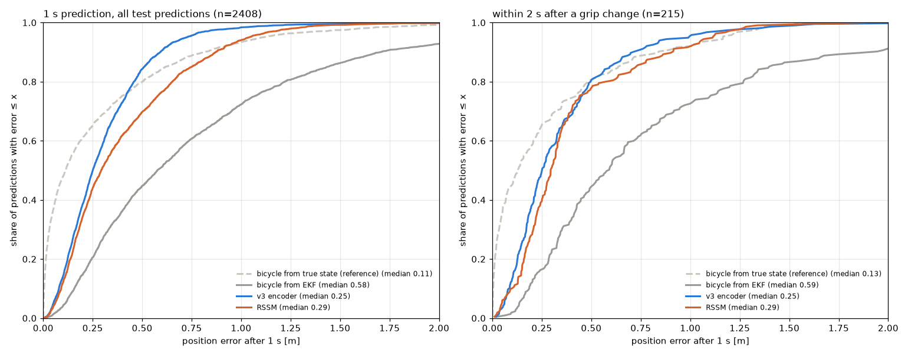

# World-model SIT-LMPC: closed-loop status

ESE 6150 Team 8, 23 Nov 2026, branch `world-model`. Details of the model and training are in `docs/WORLD_MODEL_RSSM.md`.

## Summary

The RSSM world model (LiDAR, IMU, wheel speed and PF pose in, bicycle model inside the prediction) is running inside
the SIT-LMPC planner. Offline it predicts better than the bicycle model with an EKF, gives good slip and yaw-rate
estimates, tracks grip and predicts LiDAR scans. In closed loop the car crashes within one to three learned laps. In
each crash the planner chose a manoeuvre that spun the car, while the model predicted it would stay stable. Adding
more data, including the planner's own laps and hard manoeuvres, has not fixed this. Our current explanation is that
the planner keeps finding the places where the learned model is too optimistic, and those are at the grip limit.

## System

- World model: GRU memory (128) plus a latent split into a slow condition part (8, random-walk prior) and a fast part
  (24). Inputs every 0.1 s: 64-beam LiDAR, IMU, wheel speed, PF pose and the last command.
- The physical state is rolled forward inside the model as bicycle(x, u) plus a learned residual. An anchor head gives
  steering, speed, yaw rate and slip.
- Trained with LiDAR and IMU/wheel reconstruction, KL, an anchor loss, a 1 s prediction loss and a grip/mass head.
  523k parameters, about 30 min per run on a laptop GPU.
- Data: 612k steps of 0.1 s on Spielberg, custom1 and the Levine sim map. Random vehicles, grip and mass changes,
  low-grip patches, 179k steps of the planner's own laps from earlier runs, and hard throttle/brake/steering episodes.
- In the planner, the model is filtered every step and LMPPI rolls all 1024 candidates through it for 15 × 0.1 s.
  Planning takes 38 ms median and 60 ms p95 on the laptop.

## Offline results

Held-out test set, 4,688 predictions of 1 s. Each model starts from its own sensor-based state estimate.

| | Bicycle + EKF | v3 encoder model | World model (rssm-v7) |
|---|---|---|---|
| Position error after 1 s, median | 0.44 m | 0.22 m | 0.29 m |
| Position error after 1 s, 90th percentile | 1.55 m | 0.64 m | 0.81 m |
| Same, within 2 s of a grip change (median) | 0.52 m | 0.26 m | 0.31 m |
| Steering / speed / yaw rate / slip RMSE | 0.029 / 0.25 / 0.050 / 0.044 | 0.012 / 0.21 / 0.132 / 0.019 | 0.013 / 0.22 / 0.058 / 0.018 |
| Grip error, 8 s average | – | 0.133 | 0.095 |

Reconstructed LiDAR matches the walls and the 1 s-ahead scans are close to the real ones (TensorBoard logs in
`runs/rssm-v7/tb`). The bicycle model started from the true state would be almost perfect here, since the simulator
itself is the bicycle model with nominal parameters.

The plot below is from an earlier evaluation (rssm-v5, 2,408 predictions); v7 looks much the same.

## Closed-loop runs

Spielberg, ROS lockstep sim, 5 pure-pursuit warm-up laps, then SIT-LMPC with the world model.

| Run | What happened |
|---|---|
| rssm-v5, normal warm-up | Crashed 3.4 s into the first learned lap. The warm-up reached 14.7 m/s; the Spielberg training data only went to 10.3 m/s. |
| rssm-v5, warm-up capped at 9 m/s (2 runs) | Crashed at the first corner after 9–10 s, both times. |
| Known model, same capped warm-up | All 8 laps, no crash. Laps got slower though (68.8, 68.3, 83.7 s), so the capped warm-up is not a good setup in general. |
| rssm-v6 (added the planner's laps and hard manoeuvres), normal warm-up | Two learned laps at 37.4 s and 36.7 s, both faster than the 38.0 s warm-up. Crashed early in lap 8. |
| rssm-v7 (more spin data, high-slip windows oversampled) | One learned lap (38.3 s), then crashed at about 14 m/s in lap 7. |

We replayed each crashed lap (`scripts/replay_rssm_crash.py`): at every step, predict 1.5 s ahead with the controls that
were actually used and compare with what happened.

| Crash | Slip 1.5 s later (actual) | Slip predicted by the world model | 1.5 s position error: world model from its estimate / world model from the true state / bicycle from the true state |
|---|---|---|---|
| v5, first corner, ~3 m/s | 1.07 rad | 0.12 rad | 0.33 / 0.14 / 0.00 m (median over the lap) |
| v6, lap 8, ~8 m/s | 1.11 rad | 0.32 rad | 0.47 / 0.36 / 0.01 m (last 10 steps) |
| v7, lap 7, ~14 m/s | −0.75 rad | −0.19 rad | 0.80 / 0.82 / 0.00 m (last 10 steps) |

## What we think is going on

- LMPPI picks the candidate with the best predicted outcome at every step. If the model is too optimistic about an
  aggressive corner entry, that candidate wins. More data reduces the error but the planner still finds what is left,
  and that is always near the limit where there is least data.
- The learned residual seems to damp spins. Just before the v7 crash the world model is 0.8 m off even when started
  from the true state, while the bicycle model is exact. The residual is mostly fit on normal driving, and near the
  limit it holds back the slip growth the physics would otherwise predict.
- Spin onset is rare in the data. Even now, steps with slip above 0.5 rad are under 1% of the training set.

## What we tried

| Change | Reason | Result |
|---|---|---|
| Warm-up capped at 9 m/s | keep the planner inside the model's data | still crashed; the known model did not |
| 232 fast Spielberg episodes (8–14 m/s) | speed coverage | 88% crashed during collection, only 1.4% of Spielberg data ended up above 11 m/s |
| The planner's own laps from 35 earlier runs (179k steps) | train on the driving the planner actually does | first clean learned laps (v6) |
| 450 hard throttle/brake/steering episodes | show the model where the car spins | part of v6; spins still under-predicted |
| Cut spins at 1.2 rad instead of 1.0, and draw 15% of each batch from high-slip windows | more spin examples | v7: offline about the same, spins still under-predicted |
| Posterior mean instead of a sample for the state estimate | remove sampling noise | offline median 0.34 → 0.29 m, no closed-loop change |

## Possible next steps

| Idea | How | Downside |
|---|---|---|
| Uncertainty in the planner | the model gives an uncertainty (ensemble or latent spread) and LMPPI penalises uncertain candidates | the model has to know it is wrong exactly where it has the least data; needs calibration |
| Bicycle-model check | also roll candidates through the bicycle model and drop ones where it predicts a spin or disagrees a lot with the world model | the bicycle model is only approximate on the real car, and it covers up the world model's errors |
| Grip and stiffness from the latent instead of a free residual | spins come from the physics | not pursued |
| Turn the residual down at high slip | limit the damping effect | not pursued |
