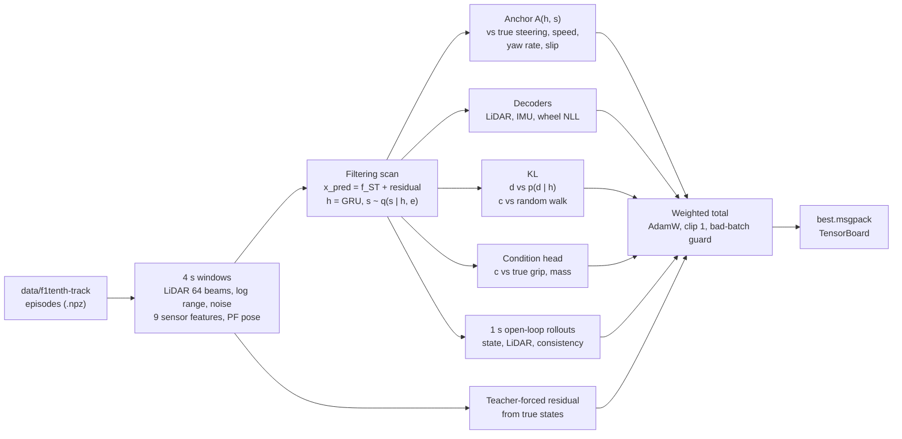
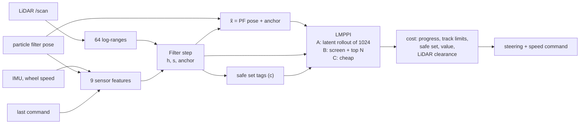
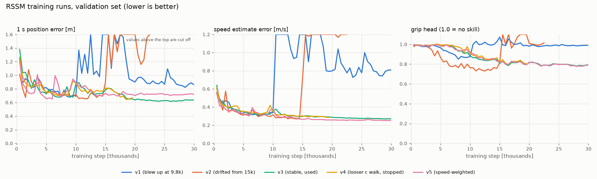
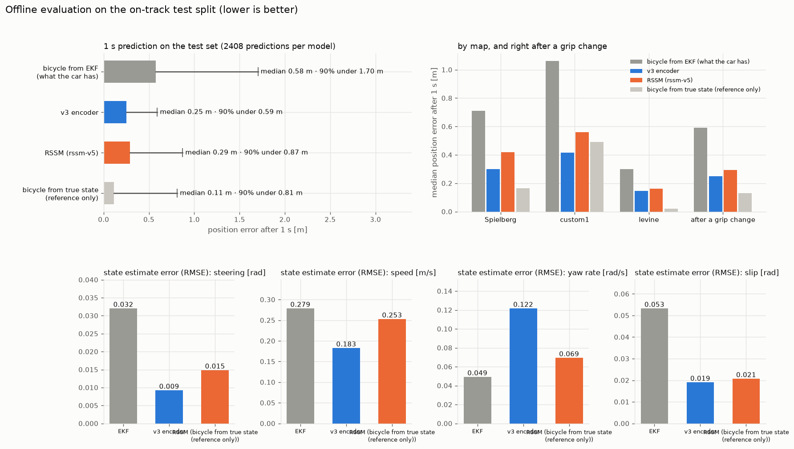
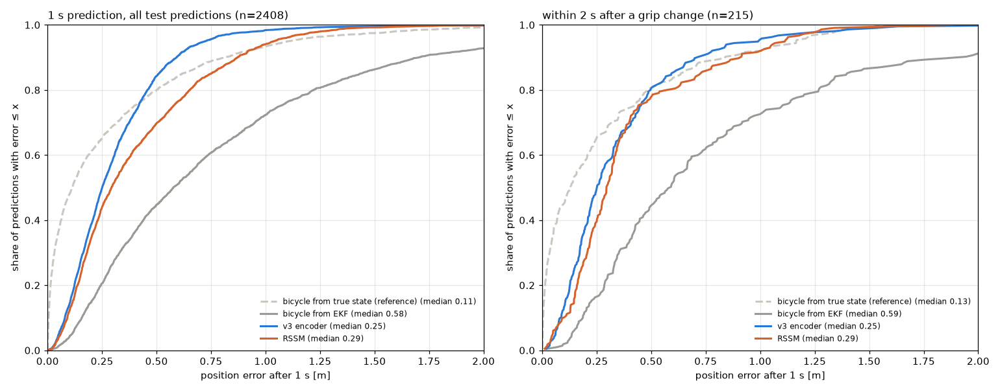

# Adaptive world-model SIT-LMPC (RSSM)

ESE 6150 Team 8, branch `world-model`. Started 2026-11-21 after the TA asked for a real world model rather than an
adaptive dynamics model. The earlier encoder model (v3, `docs/WORLD_MODEL.md`) is kept as a baseline.
Last updated 2026-11-22.

Contents: 1 Summary · 2 Differences from v3 · 3 Notation · 4 Inputs · 5 Model structure · 6 Equations ·
7 Losses · 8 Training procedure · 9 Data · 10 Planning · 11 Data flow diagrams · 12 Files and commands ·
13 Change log · 14 Results · 15 Open items

## 1. Summary

| Item | State |
|---|---|
| What it is | A recurrent state-space world model: memory h (GRU) + stochastic latent s, filtered every 0.1 s from LiDAR, IMU, wheel speed and PF pose, with the bicycle model kept inside its prediction |
| Size | 523,269 parameters (GRU 128, latent 8 + 24, LiDAR 64 beams) |
| Data | 789 on-track episodes, 293k transitions, 3 maps, 1080-beam LiDAR, grip/mass changes and low-grip patches |
| Training | v3 and v5 stable over 30,000 steps (v1 and v2 went unstable, fixed); reconstructed LiDAR walls line up with the real ones; grip head weak (~0.8) but usable |
| Test results (`rssm-v5`, posterior mean) | 1 s position error median 0.29 m (v3 encoder 0.25 m, bicycle from EKF 0.58 m); best yaw-rate estimate of the three (0.069 rad/s) |
| Planner | variant A (full latent rollout, 1024 candidates, 15 × 0.1 s) is the default for sim work; B, C and 10 × 0.15 s will be options |
| Timing | laptop: every variant ~30 ms p95 per step; Jetson not measured yet (`bash scripts/jetson_timing.sh`) |
| Next | planner integration (step F) |

## 2. How it differs from the v3 encoder model

| | v3 encoder model | RSSM world model | Why the change |
|---|---|---|---|
| Inputs | IMU, wheel speed, PF pose, last control | + downsampled LiDAR (64 beams) | a world model should see the world, not only the car |
| Latent | z (16) only describes the car | h (memory) + s = c (8, conditions) + d (24, fast) | separate "what the car is like" (slow) from "what is happening now" (fast) |
| What it predicts | next state | next state **and** what the sensors will read (LiDAR, IMU, wheel) | predicting observations forces the latent to hold real information |
| Prediction | bicycle + b + B·z, z fixed | bicycle + residual(x, u, h, s), with h and s rolled forward | the memory and fast latent follow the car through a manoeuvre |
| Planning | z fixed over the plan | full latent rollout (A), or two-stage (B) | lets the plan "imagine" sensors, e.g. predicted LiDAR clearance |
| Safety | track limits + safe set | + predicted LiDAR clearance term | catches plans the model expects to bring the car close to a wall |
| Safe set tags | grip read-out per lap / per stretch | latent c per stored state, matched by distance | c is the model's own condition variable |

## 3. Notation

| Symbol | Size | Meaning |
|---|---|---|
| $x_t$ | 7 | physical state at the centre of gravity: $(p_x, p_y, \delta, v, \psi, r, \beta)$ = position, steering angle, speed, heading, yaw rate, slip angle |
| $b(x)$ | 4 | body part of the state $(\delta, v, r, \beta)$, divided by scales $(0.4, 10, 2, 0.3)$ before entering a network |
| $u_t$ | 2 | control (steering rate, acceleration), divided by $(3.2, 9.51)$ before entering a network |
| $o_t$ | 9 + 64 | observation: 9 sensor features (section 4) and 64 LiDAR log-ranges |
| $h_t$ | 128 | GRU memory |
| $s_t = (c_t, d_t)$ | 8 + 24 | latent: $c$ slow condition part, $d$ fast part |
| $e_t$ | 128 | observation embedding |
| $\hat b_t = A(h_t, s_t)$ | 4 | anchor head output: estimated steering, speed, yaw rate, slip |
| $\tilde x_t$ | 7 | filtered state: PF pose $(p_x, p_y, \psi)$ + anchor $\hat b_t$ |
| $f_{ST}$ | — | F1TENTH single-track (bicycle) model, nominal sim-car parameters, RK4 with 0.02 s substeps |
| $\Delta t$ | — | 0.1 s control period |

## 4. Inputs

### 4.1 Sensor features (9 per step, `sit_lmpc.world.data.observations`, same as the v3 encoder)

| # | Feature | Source |
|---|---|---|
| 1–2 | IMU acceleration x, y (body frame) | IMU |
| 3 | gyro yaw rate | IMU |
| 4 | wheel speed | VESC / wheel odometry |
| 5–6 | PF pose change in the previous body frame, divided by $\Delta t$ | particle filter |
| 7 | PF heading change divided by $\Delta t$ | particle filter |
| 8–9 | previous control (steering rate, acceleration) | the command applied in the last step |

Normalised with the training-set mean and standard deviation (`observation_scale.npz` in each run).

### 4.2 LiDAR (64 values per step, `sit_lmpc.world.rssm_data`)

| Step | Operation | Why |
|---|---|---|
| 1 | full scan: 1080 beams over 270° (−135° right to +135° left) | matches the car's LiDAR |
| 2 | split into 64 equal groups, keep the **closest** return in each | a downsampled scan must never lose the nearest wall |
| 3 | clip to 0.05–10 m, take the natural log | walls nearby matter more than far ones; log range evens out the scale |
| 4 | training only: Gaussian noise (σ 0–0.03 m per window), 1% of beams set to max range | robustness to real sensor noise and dropouts |

## 5. Model structure (`src/sit_lmpc/world/rssm.py`)

All MLPs are Dense → ELU → Dense → ELU → Dense. "Gaussian" outputs are split into a mean and a log standard
deviation, the log std clipped to [−6, 2].

| Module | Input → output | Layers | Parameters | Why it is there |
|---|---|---|---|---|
| LiDAR encoder | 64 log-ranges → 512 | Conv1D 16 ch, kernel 5, stride 2 → ELU → Conv1D 32 ch, kernel 5, stride 2 → ELU (16 × 32, flattened) | 2,688 | small, fast, picks up wall shapes |
| Observation encoder | [512 LiDAR features, 9 sensor features] = 521 → $e_t$ 128 | MLP 128, 128 | 99,840 | one vector per step for the posterior |
| GRU cell | input $[s, u, b(x')]$ = 38, state 128 | Flax GRUCell | 64,256 | memory of what has been seen |
| Prior | $h$ 128 → $(\mu, \log\sigma)$ of $d$, 2 × 24 | MLP 128, 128 | 39,216 | predicts the fast latent when there is no observation (planning) |
| Posterior | $[h, e]$ 256 → $(\mu, \log\sigma)$ of $s$, 2 × 32 | MLP 128, 128 | 57,664 | updates the latent from the current sensors |
| Residual | $[b(x), u, h, s]$ = 166 → 7, × 0.1 | MLP 128, 128 | 38,791 | correction to the bicycle model |
| Anchor | $[h, s]$ 160 → 4, through a sigmoid into $[(-0.42, 0, -10, -1.2), (0.42, 20, 10, 1.2)]$ | MLP 128, 128 | 37,636 | state estimate tied to real quantities, always physical |
| LiDAR decoder | $[h, s]$ 160 → $(\mu, \log\sigma)$ of 64 log-ranges | MLP 256, 256 | 139,904 | reconstruction and the clearance safety term |
| Sensor decoder | $[h, s, u]$ 162 → $(\mu, \log\sigma)$ of 4 (IMU x, y, gyro, wheel) | MLP 128, 128 | 38,408 | reconstruction of the car's own sensors |
| Condition head | $c$ 8 → (grip, mass ratio), standardised | MLP 64, 64 | 4,866 | sim-only target that keeps $c$ about conditions |
| **Total** | | | **523,269** | |

Design rules:

| Rule | Why |
|---|---|
| Networks get only $b(x)$ (steering, speed, yaw rate, slip) and controls, never position or absolute heading | the model must not depend on where the car is or which way it points on the map |
| Pose $(p_x, p_y, \psi)$ comes from the PF and is not learned | learning absolute map position from LiDAR would tie the model to particular maps |
| Rollout states are clamped to the anchor's physical limits | an untrained or confused model must not produce impossible states |
| $c$ is carried unchanged through a planning rollout; only $d$ is sampled | matches the random-walk prior: conditions do not change within 1.5 s of imagination |

## 6. Equations

### 6.1 Filtering (every control step; training and on the car)

Start ($t = 0$): $h_0 = 0$, $s_0 \sim q(s \mid h_0, e_0)$, $\tilde x_0 = [\text{PF pose}_0, A(h_0, s_0)]$.

For $t = 1, 2, \dots$:

$$x^{pred}_t = \mathrm{clamp}\big(f_{ST}(\tilde x_{t-1}, u_{t-1}) + 0.1\, R(b(\tilde x_{t-1}), u_{t-1}, h_{t-1}, s_{t-1})\big)$$

$$h_t = \mathrm{GRU}\big(h_{t-1},\, [s_{t-1},\, u_{t-1},\, b(x^{pred}_t)]\big)$$

$$e_t = E(\text{LiDAR}_t, \text{sensors}_t), \qquad s_t \sim q(s \mid h_t, e_t) = \mathcal N(\mu^q_t, \sigma^{q\,2}_t)$$

$$\hat b_t = A(h_t, s_t), \qquad \tilde x_t = [p_{x,t}^{PF},\, p_{y,t}^{PF},\, \hat\delta_t,\, \hat v_t,\, \psi_t^{PF},\, \hat r_t,\, \hat\beta_t]$$

Priors: $p(d_t \mid h_t) = \mathcal N(\mu^p_t, \sigma^{p\,2}_t)$ from the prior head;
$p(c_t \mid c_{t-1}) = \mathcal N(\mu^q_{c,t-1},\ \sigma^{q\,2}_{c,t-1} + 0.05^2)$ (random walk from the previous posterior);
$p(s_0) = \mathcal N(0, I)$.

### 6.2 Planning rollout (prior only, from the filtered $(h_t, s_t, \tilde x_t)$)

For $k = 0, \dots, H-1$ with candidate controls $u_{t+k}$:

$$x_{k+1} = \mathrm{clamp}\big(f_{ST}(x_k, u_{t+k}) + 0.1\, R(b(x_k), u_{t+k}, h_k, s_k)\big)$$

$$h_{k+1} = \mathrm{GRU}(h_k, [s_k, u_{t+k}, b(x_{k+1})]), \qquad s_{k+1} = [c_k,\ d_{k+1}],\ d_{k+1} \sim p(d \mid h_{k+1})$$

Decoded along the rollout: LiDAR $\mu_{k}$ from $(h_k, s_k)$ for the clearance term.
In training the 1 s prediction uses the prior mean for $d$ (deterministic).

## 7. Losses (per 4 s window, averaged over steps and batch)

$\mathrm{NLL}(y; \mu, \log\sigma) = \tfrac12\big((y - \mu)/\sigma\big)^2 + \log\sigma$, averaged over dimensions.
State errors use the v3 scales $(0.1, 0.1, 0.02, 0.2, 0.02, 0.2, 0.02)$ for $(p_x, p_y, \delta, v, \psi, r, \beta)$, with heading and slip
wrapped.

| Loss | Weight | Formula | What it teaches | Why it is there |
|---|---|---|---|---|
| Anchor | 1 | mean of $\big((\hat b_t - b_t)/(0.1 \cdot \text{scale})\big)^2$ | state estimation (steering, speed, yaw rate, slip) | the planner starts from this estimate |
| Residual | 1 | scaled squared error of $f_{ST}(x_{t-1}) + 0.1R(\cdot) - x_t$, from the **true** previous state | the physics correction | learns what the bicycle model gets wrong |
| LiDAR | 1 | $\mathrm{NLL}(\text{LiDAR}_t;\ \text{decoder}(h_t, s_t))$ | reconstruct the scan | the latent must hold information about the surroundings |
| Sensors | 1 | $\mathrm{NLL}(\text{IMU}, \text{gyro}, \text{wheel};\ \text{decoder}(h_t, s_t, u_{t-1}))$ | reconstruct the car's sensors | ties the latent to motion the car feels |
| KL | 1 × warm-up | $\max\big(\overline{KL(q(d_t)\,\|\,p(d_t \mid h_t))},\ 1\big) + \overline{KL(q(c_t)\,\|\,p(c_t \mid c_{t-1}))} + KL(q(s_0)\,\|\,\mathcal N(0,I))/L$ | keep the latent predictable | the planner rolls out the prior; $c$ follows a random walk |
| Condition | 3 | squared error of the condition head on $c_t$ vs standardised (grip, mass ratio) | $c$ holds the conditions | stops $c$ absorbing driving state (the corner-dip problem) |
| Prediction | 0.3 | scaled squared state error over a 1 s (10-step) open-loop rollout, every 1 s in the window | multi-step prediction | this is exactly what the planner uses |
| Prediction LiDAR | 0.5 | LiDAR NLL along the rollout | predict future scans | trains the clearance safety term |
| Consistency | 0.5 | $\big((A(h_k, s_k) - b(x_k))/\text{scale}\big)^2$ along the rollout | latent and physical state agree | otherwise the latent could drift away from the physics during a plan |

Total $= \sum_i w_i L_i$, with the KL multiplied by $\min(1, \text{step}/3000)$.

Checkpoint selection (validation): anchor + residual + prediction + LiDAR. The KL is left out on purpose (same lesson
as the v3 KL bug: a broken or exploited KL must not decide the checkpoint).

## 8. Training procedure (`src/sit_lmpc/world/rssm_train.py`, `configs/train-rssm.yaml`)

| Setting | Value | Why |
|---|---|---|
| Window, batch | 40 steps (4 s), 32 windows | long enough for adaptation and a 1 s prediction from several start points |
| Optimiser | AdamW, warm-up then cosine decay to 5%, weight decay 1e-5 | standard |
| Gradient clip | global norm 1.0 | see change log (v1 blow-up) |
| Learning rate | 1e-4 peak (was 3e-4) | see change log (v2 drift) |
| Filter feedback | the filtered state passed to the next step carries no gradient | see change log (v2 drift) |
| Decoder noise floor | log σ ≥ −3 for LiDAR and sensor decoders | see change log (v2 drift) |
| Early stop | stop if validation is 3× worse than the best for 3 evaluations | no time wasted after a collapse |
| Bad-batch guard | drop non-finite updates; skip a batch whose loss is 20× the running average | one bad batch must not wreck Adam's statistics |
| Bicycle gradients | stopped | its low-speed branch gives NaN gradients |
| KL warm-up, free nats | 3,000 steps, 1 nat on $d$ | stop the latent collapsing early |
| Integrator | 0.02 s substeps (the planner's) | training and planning use identical physics |
| Steps | 30,000 (~28 min on the laptop GPU) | |
| Evaluation | every 500 steps on 8 fixed validation batches; figures every 500, comparison charts every 2,500 | |
| Saved | `best.msgpack`, `last.msgpack`, `observation_scale.npz`, `history.json`, `summary.json`, `config.yaml`, `tb/` | |

### 8.1 What a step, window, transition and pass mean

| Term | Meaning here |
|---|---|
| Transition | one 0.1 s step: the car was in state $x_t$, control $u_t$ was applied, 0.1 s later it was in $x_{t+1}$ (with the sensor readings and LiDAR at both times). The training split has ~228,000 transitions (~6.3 h of driving) |
| Window | a 4 s slice of one episode: 40 transitions, i.e. 41 states, 40 controls, 41 sets of sensor features, PF poses, 64-beam LiDAR scans and true grip/mass. The model filters over the window and makes 1 s predictions from several points in it |
| Training step | one weight update from one batch of 32 windows = 1,280 transitions |
| 30,000 steps | 30,000 × 32 = 960,000 windows ≈ 38 million transitions seen (~28 min on the laptop GPU) |
| Pass (epoch) | every training transition seen once. 38 M / 228 k ≈ **170 passes**: each 0.1 s moment was used ~170 times on average, in overlapping windows |

### 8.2 How windows are sampled across maps

`TrackData.sample`: pick an episode at random, every episode (at least 41 steps long) equally likely, then a random
4 s start inside it. The map mix therefore follows the number of episodes, not the amount of driving:

| Map | Share of training windows | Share of the driving data |
|---|---|---|
| Spielberg | 46.5% | 43.6% |
| custom1 | 15.6% | 20.1% |
| Levine sim | 37.9% | 36.3% |

Close to proportional across maps; custom1 (long, 60 s episodes) slightly under-sampled. Inside a map, short episodes
(many of them ended in a crash) get more windows per second of driving, so the last seconds before losing grip are
weighted up. Not a deliberate choice; sampling by transition or weighting Levine up are options.

### 8.3 TensorBoard

TensorBoard (`tensorboard --logdir runs`, localhost:6006):

| Tab | Content |
|---|---|
| SCALARS | every training loss every 50 steps, every validation metric every 500 steps, per-variable anchor errors, 1 s position error, learning rate, KL scale, skipped batches |
| CUSTOM SCALARS | per map window: steering, speed, yaw rate, slip, grip, mass (true vs model), last LiDAR scan (true / reconstructed / predicted 1 s ahead), position error vs prediction time. Tick one `diag-<step>` run; "step" there is time step or beam index |
| IMAGES | LiDAR true vs reconstructed vs predicted, LiDAR over time (columns = scans), top-down view of scan points, paths and 1 s predictions, anchor vs truth, grip read-out |

## 9. Data (`scripts/collect_track_data.py`, `data/f1tenth-track`, not in git)

| Map | Episodes (train / val / test) | Steps (train / val / test) | Speed caps |
|---|---|---|---|
| Spielberg | 283 / 36 / 35 | 100k / 15k / 15k | 4–10 m/s |
| custom1 | 95 / 12 / 12 | 46k / 6k / 6k | 5–14 m/s |
| Levine sim | 253 / 34 / 29 | 82k / 12k / 11k | 3–7 m/s (150 episodes) + 2–5 m/s (200) |

| Feature | Choice | Why |
|---|---|---|
| Vehicles | grip 0.4–1.2, cornering stiffness ±15%, mass 0.8–1.3 | same ranges as the earlier dataset |
| Changes | 30% none, 30% step change (grip and/or mass), 40% low-grip patches (1–3, 10–40 m, 35–70% of base grip) | in-lap changes are the point of the method |
| Driver | 10 Hz pure pursuit on the centre line, braking-aware speed profile, steering/accel noise | one control per 0.1 s, as the model assumes |
| Physics | dyna-dist GymST (the gym's single-track model), 0.01 s substeps | same model as the sim |
| Sensors | dyna-dist IMU / wheel / PF-pose model, per-step vehicle parameters | already validated; correct accelerations on patches |
| LiDAR | 1080 beams, 270°, bridge gym segment scanner, mounted 0.275 m ahead of the rear axle, clean (noise added in training) | same LiDAR model as the closed-loop sim |
| Crash | LiDAR clearance < 0.18 m ends the episode | data up to the crash is still good driving data |
| Spin tails | cut at load time before slip > 1.0 rad or yaw rate > 8 rad/s | see change log (v1 blow-up) |
| Splits | by episode index (every 10th test, every 9th of 10 validation) | no window shares an episode across splits |

Per-episode file: `states` (T+1, 7), `controls` (T, 2), `conditions` (T+1, 4: grip under the car, front/rear
cornering scale, mass ratio), `frenet` (T+1, 3), `lidar` (T+1, 1080, float16), `sensors` (T+1, 7) and the sensor
noise parameters. `manifest.json` lists every episode with its map, split, change, driver settings and end reason.

## 10. Planning

### 10.1 Variants

| Variant | What | Status |
|---|---|---|
| A (default for sim) | full latent rollout (section 6.2) of all 1024 candidates, LiDAR decoded for the clearance term | default |
| B | screen 1024 candidates with the cheap model, full rollout + LiDAR decode of the top N (32/64/128), re-score, MPPI-weight over N | option |
| C | cheap only: bicycle + residual with $h, s$ held fixed | option / fallback |
| Horizon | 15 × 0.1 s, or 10 × 0.15 s (control stays at 0.1 s) | option |

Unchanged from SIT-LMPC: hull safe set (capped on the car), track limits, value function. Added: LiDAR clearance
penalty; latent-tagged safe set (per lap per stretch, from the grip-filter lesson). Not built yet (step F).

### 10.2 Timing (laptop, RTX 3070, safe set capped at 4 laps, per control step)

| Variant | 15 × 0.1 s p50 / p95 | 10 × 0.15 s p50 / p95 |
|---|---|---|
| A, 1024 | 26 / 32 ms | 16 / 20 ms |
| A, 512 / 256 | 14 / 22, 11 / 19 ms | 9 / 10, 7 / 10 ms |
| B, top 32 / 64 / 128 | 27 / 33 ms (all three) | 17 / 21 ms |
| C, 1024 | 25 / 30 ms | 15 / 19 ms |

The world model adds 1–3 ms; the rest is the SIT-LMPC planner. Method: real planner with the known model on the
replay benchmark, minus its bicycle rollout, plus the world-model parts timed on the GPU with random weights
(timing does not depend on training). Jetson numbers decide the car variant.

## 11. Data flow diagrams

### 11.1 Training

### 11.2 On the car / in the sim loop (step F, planned)

## 12. Files and commands

| File | What |
|---|---|
| `src/sit_lmpc/world/rssm.py` | model, bicycle step, latent and cheap rollouts |
| `src/sit_lmpc/world/rssm_data.py` | dataset loading, LiDAR preprocessing, windows |
| `src/sit_lmpc/world/rssm_train.py` | losses, training loop, TensorBoard logging |
| `src/sit_lmpc/world/rssm_plots.py` | TensorBoard figures |
| `configs/train-rssm.yaml` | training settings |
| `scripts/collect_track_data.py` | on-track data collector |
| `tracks/levine_sim/` | Levine sim map in the planner's track format |
| `scripts/time_world_model.py`, `scripts/combine_timing.py`, `scripts/jetson_timing.sh` | timing test |
| `tests/unit/test_rssm.py` | unit tests |

| Task | Command (from the repo root, `~/sim_ws/.venv`) |
|---|---|
| Collect data | `python scripts/collect_track_data.py --out data/f1tenth-track` |
| Add Levine episodes | `python scripts/collect_track_data.py --out data/f1tenth-track --maps levine --episodes 200 --start-index 150 --speed-cap levine=2.0,5.0 --append` |
| Train | `python -m sit_lmpc.world.rssm_train --config configs/train-rssm.yaml --output runs/rssm-v2` |
| Watch | `tensorboard --logdir runs --host localhost --port 6006` |
| Timing (laptop) | `python scripts/time_world_model.py --out results/wm-timing/laptop-parts.json` |
| Timing (Jetson, one command) | `bash scripts/jetson_timing.sh` |
| Tests | `JAX_PLATFORMS=cpu python -m pytest -q tests/unit/test_rssm.py` |

## 13. Change log: what was changed and why

| Date | Change | Because | Effect |
|---|---|---|---|
| 11-21 | Physical state rolled forward inside the rollout (x' = bicycle + residual) instead of only decoded | a decoder-only state has nothing keeping 15-step rollouts physical | physics stays in every prediction |
| 11-21 | Latent split into c (slow) and d (fast) | the v3 grip read-out dipped in every corner: driving and conditions were mixed in one z | c can hold conditions only |
| 11-21 | Condition head on c (user's addition) | stop c absorbing driving state | c has a direct grip/mass target in sim |
| 11-21 | New on-track dataset with LiDAR on 3 maps | the old dataset was driven in empty space | LiDAR sees real walls |
| 11-21 | Two-stage planner (B) designed, A chosen as default | measured cost made A affordable on the laptop | B and C kept as options |
| 11-22 | Hull copied and chunked on the host, not the GPU (planner, all branches) | the planner compiled GPU code while driving: p95 236 ms, 41% of steps over 100 ms | p95 30 ms, none over 100 ms |
| 11-22 | Timing measured instead of estimated | estimate (135 ms+) was far too pessimistic | world model costs 1–3 ms per step |
| 11-22 | Collector: centre line, low noise, braking-aware speed profile, per-map caps, s-hint for the track frame | first drives weaved, overspeeded into corners and crashed in seconds | most crashes are now real grip losses |
| 11-22 | LiDAR scanned in chunks of 16 on the GPU, padded to a fixed length | batching all poses needed 101 GB; each new length recompiled | 600 scans in 50 ms |
| 11-22 | 200 extra Levine episodes at 2–5 m/s | Levine (our real track) crashed 77% of the time and had 11% of the data | Levine 105k steps, crashes ~40% |
| 11-22 | Networks see only steering, speed, yaw rate, slip | first version fed the absolute heading | model independent of where the car points |
| 11-22 | Anchor bounded (sigmoid), rollout states clamped | untrained anchor gave impossible states; rollout exploded (54 m error) | finite losses |
| 11-22 | No gradients through the bicycle model | its low-speed branch gives NaN gradients | training runs |
| 11-22 | Bicycle casts inputs to the parameter dtype | tests (64-bit) failed with a dtype error | 5/5 tests pass |
| 11-22 | TensorBoard: curves, custom-scalar comparisons, figures, top-down LiDAR | user wanted to see training, reconstructions and outputs | localhost:6006 |
| 11-22 | Spin tails cut from the data; clip 10 → 1; non-finite updates dropped; bad-batch guard | `rssm-v1` blew up at step 9,800 (losses ×100) on batches with out-of-range spin states | `rssm-v2` past step 10,500 with no spike, no skipped batch |
| 11-22 | Condition-head weight 1 → 3 | grip head only reached 0.85 in v1 (1.0 = no skill) | v2: 0.74–0.76; v3: 0.78–0.80 |
| 11-23 | `rssm-v5`: speed weighted 3× in the anchor loss (per-variable anchor weights), prediction weight 0.3 → 0.6 | offline evaluation: RSSM speed estimate 0.29 m/s vs 0.18 for v3, 1 s error 0.35 m vs 0.25 m | stable; small mixed change (median 0.35 → 0.34 m, speed 0.29 → 0.28 m/s) |
| 11-23 | First sim test of variant A (`rssm-latent`, `rssm-v5`): crashed 3.4 s into the first learned lap | **the model had never seen these speeds on Spielberg**: the Spielberg training data was capped at 4–10 m/s (max 10.3 m/s, 0% above 11 m/s) to cut crashes in collection, but the pure-pursuit warm-up laps drive above 11 m/s 24% of the time (max 14.7 m/s). Out of its training range the speed estimate read ~1.1 m/s low at 13.6 m/s and the plans weaved (yaw rate swinging ±3.5 rad/s) into the wall | collect ~250 more Spielberg episodes at 8–14 m/s, retrain (`rssm-v6`), re-evaluate, rerun the sim test |
| 11-23 | Warm-up capped at 9 m/s (`configs/world/rssm-latent-slow.yaml`); known-model control run; LiDAR and GRU memory logged per step (`rssm_lidar.npy`, `rssm_memory.npy`); crash replay script | second sim test still crashed at the first corner; needed to tell model error from setup | known model with the same setup completes all laps; replay shows the RSSM predicted no spin where the car spun (section 14.5) |
| 11-23 | Sim test, first try: no LiDAR reached the model | the bridge publishes the ego scan at `/scan`, outside the car namespace; the adapter listened on `/ego_racecar/scan` | `lidar_topic: /scan` in `configs/world/rssm-latent.yaml` |
| 11-23 | State estimate from the posterior mean, not a random sample, in evaluation and planning (`run_sequence(..., sample=False)`); training still samples | the RSSM's estimates used a random draw of the latent, which adds noise the v3 encoder (means) does not have | `rssm-v5`: median 0.34 → 0.29 m, speed 0.28 → 0.25 m/s, yaw rate 0.097 → 0.069 rad/s |
| 11-22 | Prediction weight 1 → 0.3; filtered state fed back without gradient; decoder noise floor (log σ ≥ −3); learning rate 3e-4 → 1e-4; early stop | `rssm-v2` drifted from step ~15,000 with all losses rising together (no single bad batch): prediction was ~90% of the loss and backpropagated through 10 GRU steps, the filter's own estimate was fed back with gradients across the window, decoders could become overconfident, learning rate still ~2.3e-4 | `rssm-v3` stable for all 30,000 steps and the best of the three; several changes at once, so the decisive one is not isolated |

## 14. Results

### 14.1 Training validation (per training run)

| Run | Step | Anchor error: steering / speed / yaw rate / slip | 1 s position | Grip head | Note |
|---|---|---|---|---|---|
| rssm-v1 | 9,000 (best) | 0.016 / 0.30 / 0.12 / 0.025 | 0.69–0.78 m | 0.85 | unstable afterwards |
| rssm-v2 | 10,500 (best) | 0.015 / 0.28 / 0.10 / 0.019 | 0.66 m | 0.76 | drifted from step ~15,000 |
| **rssm-v3** | **26,500 (best)** | **0.014 / 0.27 / 0.086 / 0.019** | **0.62 m** | 0.80 | stable to 30,000 (final 0.014 / 0.27 / 0.084 / 0.018, 0.64 m); LiDAR NLL −1.19 |
| rssm-v4 | 18,000 (stopped) | 0.016 / 0.30 / 0.095 / 0.020 | 0.69 m | 0.83 | looser random walk on c (0.2); no better than v3 |
| rssm-v5 | 17,000 (best) | 0.017 / 0.26 / 0.10 / 0.022 | 0.69 m | 0.79 | speed weighted 3×, prediction 0.6; stable to 30,000 |
| v3 encoder (offline eval, different data) | — | steering 0.010, speed 0.44, slip 0.020 | 0.53 m (median, 1 s) | grip R² 0.91 (lap average) | not directly comparable yet; step E compares on the same data |

Grip head: mean squared error on standardised grip and mass; 1.0 = no better than guessing the average.

### 14.2 Offline evaluation on the test split (`scripts/eval_world_models.py`)

Protocol, the same for every model:

| Item | Choice | Why |
|---|---|---|
| Data | on-track test split: 301 windows of 10 s from 76 test episodes (Spielberg, custom1, Levine) | episodes never used in training or checkpoint selection |
| Warm-up | every estimator (EKF, v3 encoder, RSSM filter) starts fresh at the window start and gets 2 s to settle | same history for everyone |
| Predictions | from every 1 s after the warm-up, predict 1 s ahead with the true controls: 2,408 predictions per model | the planner's horizon is 1–1.5 s |
| Start state | each model starts from its own estimate, built from sensors only | what each would have on the car |
| Bicycle (EKF) | nominal single-track model from the bicycle-model EKF | the classic setup (known model) |
| Bicycle (true state) | nominal single-track model from the true state | reference only: model error without estimation error |
| v3 encoder | residual transition with the encoder's z, from PF pose + encoder state | previous method; trained on the map-free data, never saw these tracks |
| RSSM | latent rollout (prior mean) from the filtered state | this model |
| After a change | predictions where the true grip changed within 2 s before or during the prediction (215 of 2,408) | in-lap adaptation |

Results (rows marked "sampled" used a random draw of the latent for the state estimate; "mean" uses the posterior
mean, which is what the planner uses; see the change log for 11-23):

| Model | 1 s position error, mean | median | 90% under | heading (median) | speed (median) |
|---|---|---|---|---|---|
| Bicycle from EKF | 0.81 m | 0.58 m | 1.69 m | 0.176 rad | 0.18 m/s |
| **v3 encoder** | **0.31 m** | **0.25 m** | **0.59 m** | **0.041 rad** | **0.13 m/s** |
| RSSM `rssm-v3`, sampled | 0.46 m | 0.35 m | 0.95 m | 0.069 rad | 0.21 m/s |
| RSSM `rssm-v5`, sampled | 0.45 m | 0.34 m | 0.96 m | 0.070 rad | 0.20 m/s |
| **RSSM `rssm-v5`, mean** | **0.40 m** | **0.29 m** | **0.87 m** | **0.058 rad** | **0.18 m/s** |
| Bicycle from true state (reference) | 0.29 m | 0.11 m | 0.81 m | 0.030 rad | 0.00 m/s |

| Median 1 s position error by group | Spielberg | custom1 | Levine | After a grip change |
|---|---|---|---|---|
| Bicycle from EKF | 0.71 m | 1.06 m | 0.30 m | 0.59 m |
| v3 encoder | 0.30 m | 0.42 m | 0.15 m | 0.25 m |
| RSSM `rssm-v3`, sampled | 0.47 m | 0.60 m | 0.20 m | 0.35 m |
| RSSM `rssm-v5`, sampled | 0.45 m | 0.59 m | 0.19 m | 0.31 m |
| **RSSM `rssm-v5`, mean** | **0.42 m** | **0.56 m** | **0.16 m** | **0.30 m** |
| Bicycle from true state | 0.16 m | 0.49 m | 0.02 m | 0.13 m |

| State estimation RMSE | Steering | Speed | Yaw rate | Slip |
|---|---|---|---|---|
| EKF | 0.032 rad | 0.28 m/s | **0.050 rad/s** | 0.054 rad |
| v3 encoder | **0.009 rad** | **0.18 m/s** | 0.122 rad/s | **0.019 rad** |
| RSSM `rssm-v3`, sampled | 0.013 rad | 0.29 m/s | 0.081 rad/s | 0.020 rad |
| RSSM `rssm-v5`, sampled | 0.017 rad | 0.28 m/s | 0.097 rad/s | 0.024 rad |
| **RSSM `rssm-v5`, mean** | 0.015 rad | 0.25 m/s | **0.069 rad/s** | 0.021 rad |

| Grip absolute error | Every step | Averaged over each window |
|---|---|---|
| v3 read-out | 0.117 | 0.085 |
| RSSM condition head `rssm-v3`, sampled | 0.115 | 0.093 |
| RSSM condition head `rssm-v5`, mean | 0.120 | 0.105 |

What it means:

| Finding | Detail |
|---|---|
| The RSSM works | ~40% lower 1 s error than the bicycle model from the EKF (what the car has today), grip tracking about equal to v3, and it predicts LiDAR, which v3 cannot |
| The v3 encoder is better at dynamics | 0.25 m vs 0.35 m median, although it never saw on-track data or LiDAR: the map-free training data transfers to real tracks |
| RSSM's weak spot is its speed estimate | 0.29 m/s RMSE vs 0.18 m/s for v3; a wrong starting speed grows into position error over 1 s |
| Likely cause | the prediction weight was cut to 0.3 for stability, so LiDAR reconstruction takes a larger share of training than the dynamics |
| Bicycle from the true state | very accurate on Levine (slow driving) and good overall (0.11 m median), but the car never has the true state: from the EKF it is 5× worse. State estimation is the bottleneck, as found with v3 |
| `rssm-v5` (speed weighted 3×, prediction weight 0.6) | small, mixed change with sampled estimates: speed 0.29 → 0.28 m/s, median 0.35 → 0.34 m, after a grip change 0.35 → 0.31 m; steering, yaw rate, slip and grip slightly worse. Loss weighting alone does not close the gap to v3 |
| Posterior mean instead of a sample | the bigger effect: same `rssm-v5` checkpoint, median 0.34 → 0.29 m, speed 0.28 → 0.25 m/s, yaw rate 0.097 → 0.069 rad/s (now the best of the three). The remaining gap to the v3 encoder is 0.04 m median, mostly from the speed estimate |

### 14.3 Figures

Made with `python scripts/plot_wm_summary.py --eval results/wm-eval-v5-mean --label rssm-v5` and
`python scripts/plot_world_eval.py results/wm-eval-v5-mean` (RSSM = `rssm-v5`, posterior mean).

**Training runs.** Validation error against training step for every RSSM run. v1 (blue) blows up at step 9,800 and
v2 (orange) drifts from step 15,000; v3 (green) stays stable to the end and is the model in use. Values above the top
of each panel are cut off.

**Offline evaluation overview.** Top left: 1 s position error per model (bar = median, line to the 90% value). Top
right: median by map and right after a grip change. Bottom: state-estimate error for each quantity.

**Cumulative plot (how to read):** for any error on the x-axis, the height of a line is the share of predictions that
were at least that accurate. Higher and further left is better. Left: all 2,408 test predictions. Right: the 215 made
within 2 s of a grip change. The v3 encoder (blue) is best overall; the RSSM (orange) is close behind and almost
overlaps it right after grip changes (up to ~0.5 m error), and both are far better than the bicycle model from the EKF
(dark grey), which is what the car has without a learned model. The dashed
line (bicycle from the true state) is a reference the car can never reach, because it needs the exact true state.

### 14.4 First sim test (variant A, `rssm-v5`)

| Item | Result |
|---|---|
| Plumbing | LiDAR feed, per-step filter and world-model planning all run; planning 38 ms median, 60 ms p95 per step (laptop) |
| Warm-up laps 1–5 (pure pursuit) | normal, 38.0–38.4 s |
| First learned lap | crashed after 3.4 s: speed estimate ~1.1 m/s low at 13.6 m/s, plans weaving with yaw rate ±3.5 rad/s |
| Cause | **the model had not seen these speeds on Spielberg** (training data ≤ 10.3 m/s there; warm-up laps up to 14.7 m/s, 24% of the time above 11 m/s). A learned model is only trustworthy inside the conditions it was trained on |
| Lesson | the data must cover the speeds the planner will actually drive, not only speeds the data collector can drive safely |

### 14.5 Second sim test: warm-up capped at 9 m/s, control run and crash replay

| Run | Result |
|---|---|
| RSSM, warm-up capped at 9 m/s (twice, the second with LiDAR and memory logged) | warm-up 63.7–63.8 s; first learned lap braked to 3–4 m/s and crashed at the first corner (~29 m) after 9–10 s, both times |
| Known model, same setup (control) | 8/8 laps, no crash, but learned laps got slower (68.8, 68.3, 83.7 s): slow warm-up laps make SIT-LMPC drift slower even with exact physics, so the braking is the setup, not the world model |
| Replay of the crashed lap (`scripts/replay_rssm_crash.py`) | 1.5 s position error: RSSM from its own estimate 0.33 m, RSSM from the true state 0.14 m, bicycle from the true state 0.00 m (the sim is the bicycle model with nominal parameters) |
| Cause of the crash (corrected 11-23) | the car drove into the wall at the first corner. The large slip at the end of the replay (1.07 rad) is the wall impact itself: the exact bicycle model predicts only 0.12 rad there, so it was not a spin. The first version of this section read it as a spin. From the true state the RSSM's 1.5 s rollout is 0.14 m off (median) where the v3 model is 0.02 m off; on Spielberg's ~1.1 m half-width that is enough to clip the wall. The v7 crash (lap 7, ~14 m/s) was a real spin: exact model −0.84 rad, v3 −0.49, RSSM −0.18 |
| Lessons | (1) a learned model in the planner must have seen the manoeuvres the planner will try, not only the driving style of the data collector; (2) in this sim the known model is exact when grip is nominal, so a learned model can only lose there; its value shows under changed conditions or on the real car |

## 15. Open items

| Item | Plan |
|---|---|
| Grip head weak (~0.8) | accepted for now (user decision 11-22); a looser random walk on c (v4) did not help |
| Speed estimate (0.25 vs 0.18 m/s for v3) | main remaining gap to the v3 encoder |
| Training data does not cover the planner's speeds or manoeuvres | 232 fast Spielberg episodes added (88% crashed, only 1.4% of Spielberg data above 11 m/s; `rssm-v6` stopped). Next: data from the closed-loop laps and hard accel/steer episodes, and/or a bicycle-model spin check in the planner |
| Jetson timing | `bash scripts/jetson_timing.sh` from a `world-model` clone; choose A/B/C |
| Offline evaluation (step E) | vs known model, v3 encoder, EKF; ablations without in-lap update, safe-set tags, LiDAR; two-stage vs full agreement after changes |
| Planner integration (step F) | variants A/B/C and 10 × 0.15 s as config options; LiDAR clearance term; latent-tagged safe set per lap per stretch |
| Map-free dataset | not used yet; could train the residual with LiDAR masked |
