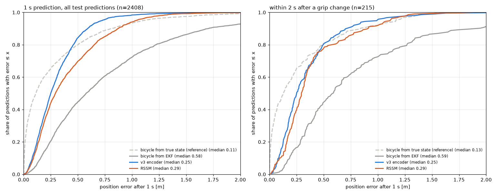

# World-model SIT-LMPC: where we are and where we are stuck

ESE 6150 Team 8, 2026-11-23. Branch `world-model`. Full documentation: `docs/WORLD_MODEL_RSSM.md`.

## 1. Summary

We built the adaptive world model you suggested (RSSM with LiDAR, IMU, wheel speed and PF pose, physics-anchored) and
plugged it into the SIT-LMPC planner. Offline it works: it beats the bicycle model + EKF pipeline on 1 s prediction,
estimates slip and yaw rate well, tracks grip, and reconstructs and predicts LiDAR. **In closed loop it crashes within
one to three learned laps.** Every crash replay shows the same thing: the planner picks a plan that spins the car, and
the world model predicts that plan will not spin. More and better data has not fixed this. We think the planner is
exploiting the learned model's errors at the handling limit, and we would like your advice on how to handle that.

## 2. What we built

| Part | What it is |
|---|---|
| World model | RSSM: GRU memory h (128) + latent s = slow condition part c (8, random-walk prior) + fast part d (24, learned prior). Inputs every 0.1 s: 64-beam LiDAR, IMU, wheel speed, PF pose, last command |
| Physics anchor | the 7-dim physical state is rolled forward inside the model: x′ = bicycle(x, u) + learned residual(x, u, h, s); an anchor head maps (h, s) to steering, speed, yaw rate, slip |
| Training | ELBO (LiDAR and IMU/wheel reconstruction + KL), anchor loss, 1 s open-loop prediction loss, condition head (grip, mass) in sim. 523k parameters, ~30 min per run on a laptop GPU |
| Data | 612k transitions (0.1 s each) on Spielberg, custom1 and the Levine sim map: random vehicles, grip/mass changes and low-grip patches, the planner's own laps from 35 earlier closed-loop runs (179k steps), and hard throttle/brake/steering episodes |
| Planner integration | the filter runs every step and gives the planner its state estimate; LMPPI rolls all 1024 candidates through the full world model (15 × 0.1 s). Planning time 38 ms median, 60 ms p95 on the laptop |

## 3. What works (offline, held-out test set, 4,688 one-second predictions)

| | Bicycle + EKF (what the car has) | Our earlier encoder model (v3) | **World model (rssm-v7)** |
|---|---|---|---|
| 1 s position error, median | 0.44 m | 0.22 m | 0.29 m |
| 1 s position error, 90% under | 1.55 m | 0.64 m | 0.81 m |
| Right after a grip change, median | 0.52 m | 0.26 m | 0.31 m |
| State estimate RMSE: steering / speed / yaw rate / slip | 0.029 / 0.25 / 0.050 / 0.044 | 0.012 / 0.21 / 0.132 / 0.019 | 0.013 / 0.22 / 0.058 / 0.018 |
| Grip error (averaged over 8 s) | — | 0.133 | **0.095** |

Reconstructed LiDAR lines up with the real walls, and 1 s-ahead scans match closely (TensorBoard figures in
`runs/rssm-v7/tb`). Each model starts from its own sensor-based estimate; "bicycle from the true state" would be
near-perfect because the simulator *is* the bicycle model with nominal parameters.

Cumulative 1 s position error from an earlier evaluation (world model `rssm-v5`, 2,408 predictions on the original
test set); the picture for v7 is very similar. Higher and further left is better.

## 4. Where we are stuck: closed loop

All runs: Spielberg, ROS lockstep sim, 5 pure-pursuit warm-up laps, then SIT-LMPC with the world model.

| Run | Result |
|---|---|
| rssm-v5, normal warm-up (up to 14.7 m/s) | crashed 3.4 s into the first learned lap. The training data on Spielberg stopped at 10.3 m/s, so the model was outside its data |
| rssm-v5, warm-up capped at 9 m/s (twice) | crashed at the first corner, 9–10 s into the first learned lap, both times |
| Known model, same capped warm-up (control) | 8/8 laps, no crash (but laps got slower: 68.8, 68.3, 83.7 s; slow warm-up is a poor setup for SIT-LMPC in general) |
| rssm-v6 (+ planner's own laps and hard-manoeuvre data), normal warm-up | **2 learned laps, both faster than warm-up (37.4 s, 36.7 s vs 38.0 s)**, then a crash early in lap 8 |
| rssm-v7 (+ more spin data, high-slip windows oversampled) | 1 learned lap (38.3 s), then a crash at ~14 m/s in lap 7 |

Replays of the crashed laps (`scripts/replay_rssm_crash.py`): at each step, predict 1.5 s ahead with the controls that
were actually applied, and compare with what happened.

| Crash | True slip 1.5 s later | World model predicted | 1.5 s position error before the crash: world model (own estimate) / world model (true state) / bicycle (true state) |
|---|---|---|---|
| v5, capped warm-up, first corner, ~3 m/s | 1.07 rad (spin) | 0.12 rad | 0.33 / 0.14 / 0.00 m (median over the lap) |
| v6, lap 8, ~8 m/s | 1.11 rad (spin) | 0.32 rad | 0.47 / 0.36 / 0.01 m (last 10 steps) |
| v7, lap 7, ~14 m/s | −0.75 rad (spin) | −0.19 rad | 0.80 / 0.82 / 0.00 m (last 10 steps) |

## 5. Our diagnosis

1. **The planner exploits the model's errors.** Every step LMPPI picks the plan with the best predicted outcome. Plans
   where the model is wrongly optimistic (an aggressive corner entry it thinks will not spin) score best, so those are
   the ones it executes. Better data shrinks the errors, but the planner keeps pushing until it finds the remaining
   ones, and they sit at the handling limit, where data is rarest.
2. **The learned residual damps spins.** Even from the true state, the world model is 0.8 m off just before the v7
   crash, while the bicycle model is exact. The residual is learned mostly from normal driving; near the limit its
   small biases suppress the slip runaway that the physics alone would predict.
3. **Spin onset is rare in any realistic data.** After all additions, steps with slip above 0.5 rad are under 1% of
   the training data.

## 6. What we tried

| Tried | Why | Result |
|---|---|---|
| Cap the warm-up at 9 m/s | keep the planner inside the model's data | still crashed; known model with the same setup did not |
| Add 232 fast Spielberg episodes (8–14 m/s) | speed coverage | 88% crashed in collection; only 1.4% of Spielberg data above 11 m/s |
| Add the planner's own laps from 35 earlier runs (179k steps) | train on the driving the planner actually does | first clean learned laps (v6) |
| Add 450 hard throttle/brake/steering episodes | teach the model where the car spins | part of v6; spin still under-predicted |
| Keep more of each spin (cut at slip 1.2 rad instead of 1.0) and draw 15% of each batch from high-slip windows | more practice on spin onset | v7: offline about the same, spin still under-predicted |
| State estimate from the posterior mean instead of a sample | remove sampling noise | clear offline gain (median 0.34 → 0.29 m), no closed-loop fix |

## 7. Options we see

| Option | Idea | Our concern |
|---|---|---|
| Uncertainty-aware planning | the model predicts its own uncertainty (ensemble or latent spread); LMPPI penalises or rejects candidates where it is high | the model must know when it is wrong exactly where it has least data; needs calibration |
| Physics cross-check in the planner | also roll each candidate through the bicycle model; reject plans where it predicts a spin or where the two models strongly disagree | on the real car the bicycle model is itself approximate; partly hides what the world model gets wrong |
| Make the physics carry the dynamics (latent sets grip and cornering stiffness, small residual) | spins come from the physics and cannot be damped away | considered; we are not keen on it |
| Limit the residual near the limit | penalise or switch off the residual at high slip | considered; we are not keen on it |

## 8. Questions for you

1. Is this "model exploitation at the limit" problem expected for learned models inside MPPI/LMPC, and is there a
   standard way you would handle it in this course's setup?
2. Would you accept a planner-level safeguard (uncertainty penalty or physics cross-check) as part of the method, or
   should the world model itself predict spins correctly?
3. If uncertainty-aware planning: is an ensemble of world models the right way to get the uncertainty, or is the
   latent's own spread enough?
4. For the final evaluation, is it acceptable to show the world model's advantage mainly in the grip-change scenarios
   (where the known model is wrong) and report the closed-loop limit as an open problem?
