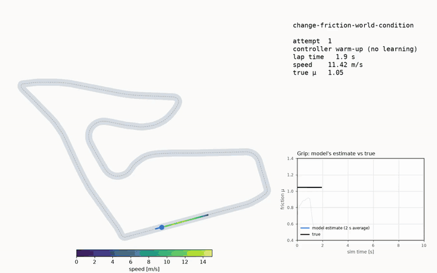
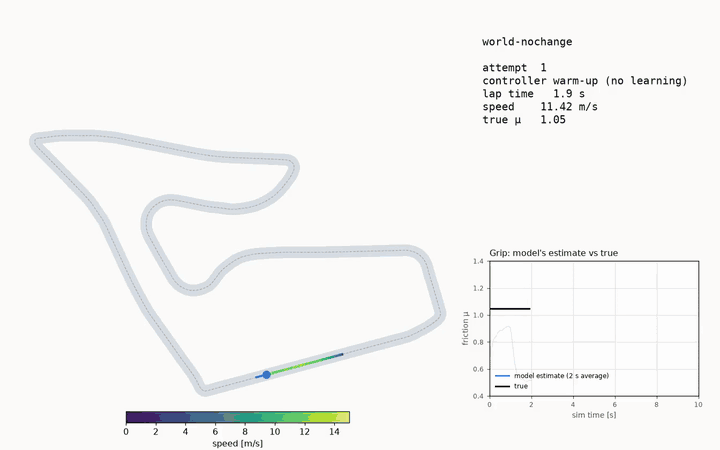

# Our method in the planner loop (sim, Spielberg, 2026-11-17)

SIT-LMPC (TAs' LMPPI planner, unchanged) driving with our world model: bicycle + b + B·z, with the encoder
(`runs/world-encoder-v3`) updating z and the hidden state (steering, speed, yaw rate, slip) every 0.1 s from simulated
IMU, wheel speed and PF pose. No chance constraints. Fast-start settings (pure-pursuit warm-up, all laps kept,
1.5 s horizon, action-rate penalty 0.1). Seed 1, 15 attempts, lockstep ROS bridge with simulated sensors.

| Run | Config | Scenario |
|---|---|---|
| `world-nochange` | `configs/world/world-nochance.yaml` | `configs/scenarios/spielberg-no-change.yaml` |
| `change-friction-world-condition` | `configs/world/world-nochance-condition.yaml` (grip filter: threshold 0.12, at least 4 laps) | `configs/scenarios/spielberg-friction-drop.yaml` (μ 1.05 → 0.75 after lap 7) |

Launched with `bash scripts/run_change_experiment.sh <config> <scenario> <name> 15`.

## Videos

Top-down view, whole run sped up (32× sim time). Full videos at 2× sim speed: [no change](videos/world-nochange.mp4),
[grip drop](videos/change-friction-world-condition.mp4) (open, then "View raw" to download if the browser does not play it).

**Grip drop** (grip chart: model's guess in blue, true grip in black, drops after lap 7)

**No change**

## Lap times (s)

| Lap | 1–5 | 6 | 7 | 8 | 9 | 10 | 11 | 12 | 13 | 14 | 15 |
|---|---|---|---|---|---|---|---|---|---|---|---|
| No change | 38.0–38.4 (warm-up) | 37.8 | 37.3 | 38.0 | 36.7 | 36.9 | 36.2 | 36.0 | **35.7** | 36.1 | spin |
| Grip drop (μ 0.75 from lap 8) | 38.0–38.4 (warm-up) | 38.0 | 37.8 | 37.8 | 37.0 | 36.6 | 36.6 | spin | 36.2 | 37.0 | **35.8** |

Both runs: 14/15 laps, planning p50 470 ms / p95 670–680 ms per step (laptop GPU, all steps).

## Grip estimate (friction read-out from z, lap average)

| | Laps 1–7 (true 1.05) | Laps 8–15 (true 0.75) |
|---|---|---|
| No change | 0.92–0.97 (laps 8–15 also 0.93–0.99) | — |
| Grip drop | 0.92–0.97 | **0.72–0.76** |

The lap average finds the drop on the first slippery lap. Within a lap the estimate swings ±0.3 with cornering
(even averaged over 2 s), so only lap-level values are reliable.

## Crashes

| Run | Attempt | Where | What |
|---|---|---|---|
| No change | 15 | s ≈ 113 m | entered at ~11 m/s (laps 12–14: ≤ 10.8 m/s), slip 0.7 rad, yaw rate −8 rad/s, wall |
| Grip drop | 12 | s ≈ 33 m (first corner, 3.4 s in) | slip 0.8 rad, yaw rate −9.6 rad/s; lap 11 already slid to 0.5 rad there. Not caused by the filter switching: during lap 12 only 3 low-grip laps were stored, so every step still used at least one high-grip lap |

## Files

`summary.json`, `lap_metrics.json`, `config.yaml`, `control_timing.json`, `encoder_friction.npy` (per step),
`conditions.jsonl` (scheduler log), `run.log`, the failed attempt's trajectory, and the runner's plots.
Full trajectories: `results/Spielberg/<run>`. Videos made with `scripts/render_run_video.py`.

Not yet run: baselines on the same scenario (known model, TAs' BNN) and ours without the grip filter.
